# DOCUMENTACIÓN EXHAUSTIVA — ESPACIO HOPE (Django monolítico)

> **FINALIDAD DE ESTE DOCUMENTO:** preservar el comportamiento actual del sistema. Es una
> radiografía de **cómo funciona HOY**, sin mejoras, sin refactor sugerido y sin lógica corregida.
> Todo desarrollador / analista / agente de IA debe asumir que el sistema funciona correctamente y
> que cualquier cambio incorrecto afecta operación en producción (la BD de desarrollo ES la BD de
> producción: MySQL de Railway, db `hope`).
>
> Verificado contra el código en disco: `core/views.py` = 9,392 líneas · `core/models.py` = 1,275
> líneas · 62 migraciones (0001–0060, con dos 0026/0036/0039 duplicadas por rename; 0060 = 
> `LogEnvioReporteIPP`, añadida el 28/10/2026 para el monitor de envío IPP) ·
> `core/urls.py` = 155 líneas · `hope_project/settings.py` = 230 líneas.
>
> ✅ **Cambio del 28/10/2026 — Módulo "Monitor de Envío de Reportes IPP"** (solo observación,
> auditoría y reenvío manual): modelo `LogEnvioReporteIPP` (migración 0060), vista
> `/panel-admin/ipp-email-monitor/`, endpoint POST `/panel-admin/api/reintentar-envio-ipp/<id>/`,
> template `panel_admin_ipp_monitor.html` y registro de solo lectura en Django admin. NO modifica
> el pipeline de reportes (`_procesar_reporte_de_una_cita_detallado` queda intacto). Ver §4.2.24 y §11.4.
>
> ⚠️ **Advertencia general:** correr `manage.py runserver` local habla con la BD **de producción**.
> Cualquier `migrate`, comando de gestión que escribe, o clic en un admin de Django es un cambio de
> producción real.

---

## TABLA DE CONTENIDO

1. Visión General
2. Arquitectura Completa
3. Tecnologías
4. Modelo de Datos (diccionario + ER)
5. Roles y Permisos
6. Agendación
7. Pacientes
8. Horarios
9. Expedientes
10. Bitácoras
11. APIs (catálogo completo de endpoints)
12. Flujo Completo de Negocio
13. Reglas de Negocio
14. Dependencias Críticas
15. Riesgos (qué NO debe tocarse)
16. Manual Técnico
17. Manual Operativo
18. Mapa General del Sistema

---

# 1. VISIÓN GENERAL

## 1.1 Objetivo del sistema

**Espacio HOPE** es una plataforma de atención psicológica en línea (telepsicología) que opera como
organización multiservicio y multi-marca:

- **HOPE público general**: patients se registran, llenan cuestionario clínico, pagan una sesión
  (PayPal o tarjeta vía Clip), son asignados a un psicólogo, reciben enlace de Google Meet,
  sesionan, una IA (Groq) les genera bitácoras y reportes PDF "Check-In" que se envían por correo
  al paciente y al psicólogo tras cada sesión.
- **TECTUM In-House** (`tectuminhause.*`): programa corporativo de salud mental con **cobertura
  100%** (el convenio paga; el colaborador no paga nada). Solo colaboradores de la lista blanca
  hardcodeada `COLABORADORES_TECTUM` pueden entrar.
- **TECTUM Beneficios** (`tectumbeneficios.*`): tier corporativo pago; el usuario paga como HOPE
  (PayPal o Clip) pero con marca TECTUM.
- **Programas comunitarios**: landings y formularios de "comunidad" Venezuela y Colombia
  (`ContactoVenezuela`, `ContactoPais`), donaciones (PayPal/Clip con `tipo_servicio='donativo'`),
  talleres (registro público), encuestas en vivo (insights + nube de palabras), encuesta clínica
  GHQ-30 de TECTUM.

## 1.2 Problema que resuelve

- Dotar a psicólogos independientes y a la operación de HOPE de un expediente clínico digital,
  agendamiento con control de disponibilidad por psicólogo, cobro automático, sesiones Meet,
  bitácoras asistidas por IA y reportes PDF automáticos post-sesión sin intervención manual.
- Corporativizar el servicio: mismo backend, distinta marca, distintos precios (0 en In-House) y
  distinta lista de acceso, según el subdominio por el que ingresa el usuario.
- Medir la operación (KPIs, crecimiento, retención, satisfacción) desde dashboards internos.

## 1.3 Usuarios involucrados

| Actor | Cómo entra | Dónde opera |
|---|---|---|
| **Paciente HOPE** | `/informativo/` (botón "login"), registro AJAX, login | `/panel/` (`panel_generico.html`) |
| **Paciente TECTUM In-House** | host `tectuminhause.espaciohope.com` o `/convenio-tectum/` | `/panel-tectum/` (`tectum/panel-tectum.html`) |
| **Paciente TECTUM Beneficios** | host `tectumbeneficios.espaciohope.com` o `/convenio-beneficios/` | `/panel-beneficios/` (`tectum_beneficios/panel-beneficios.html`) |
| **Psicólogo** | login por rol (necesita row `PerfilPsicologo` ligada a su `User`) | `/panel-doctor/` (`panel_doctor.html`), `/repositorio-clinico/`, `/paciente/<id>/` |
| **Administración / Dirección (superuser)** | login por rol o `/admindoc/` | Django admin en **`/error-59/`** (¡no `/admin/`!), `/panel-admin/*` |
| **Visitante anónimo** | landings, talleres, encuestas, formularios país, donaciones | múltiples |
| **Equipo interno (buzón)** | recibe correos a `contacto@espaciohope.com` | correo |

## 1.4 Procesos principales

1. **Registro → Cuestionario clínico** (`CUESTIONARIO_CLINICO` en `core/cuestionario_data.py`,
   flujos `individual` / `pareja` / `familiar` / `solo_talleres`; el mismo dict se replica para los
   tres flujos clínicos).
2. **Selección de servicio → disponibilidad → pago → cita** (PayPal Smart Buttons o pasarela Clip).
3. **Pre-sesión**: consentimiento informado firmado (canvas + PDF), formulario previo al Meet (IPP
   de 12 reactivos + satisfacción).
4. **Sesión** en Google Meet (evento creado con la cuenta de servicio/token de HOPE).
5. **Post-sesión**: bitácora manual del psicólogo **o** bitácora automática IA (notas Meet → Groq);
   cita pasa a `Completada`.
6. **Reportes**: ~2 h después de la sesión el pipeline genera 2 PDFs (paciente y psicólogo) y los
   envía por correo adjuntos, archivándolos en `ReporteClinicoPDF`.
7. **Operación**: tablero admin, reporte de crecimiento, chats IA para admin, repositorio clínico.

## 1.5 Dependencias internas y externas

**Internas:** coordenado por 3 archivos gordos (`views.py`, `models.py`, `admin.py`) + un
utilitario (`utils_pdf.py` + `cuestionario_data.py`) + 4 comandos de gestión + ~70 templates.

**Externas (y qué pasa si caen):**
- **Google Calendar API v3 + Google Meet** (token OAuth `GOOGLE_TOKEN_JSON`): sin ella no hay
  link de Meet ni bitácora automática (la cita sigue funcionando sin Meet si la modalidad lo
  permite).
- **Groq Cloud** (`GROQ_API_KEY`): bitácoras IA, síntesis, análisis de gráfica IPP, análisis de
  archivos, chat "HOPE AI" admin y consulta del repositorio. Con excepciones de check-in, en
  muchos endpoints la app muestra un **error al usuario** si Groq falla.
- **SMTP Zoho** (`smtp.zoho.com:465`, SSL, `contacto@espaciohope.com`, contraseña de aplicación en
  env var): correos de confirmación, reportes, mood, talleres, recuperación de contraseña.
- **Clip** (`api.payclip.com/v2/checkout`, `CLIP_API_KEY_PROD` + `CLIP_CLAVE_SECRETA_PROD`): pago
  con tarjeta; **sin webhook ni verificación de firma** — el "pagado" se asume cuando el
  navegador regresa a `/pago-exitoso/<id>/`.
- **PayPal** (`PAYPAL_CLIENT_ID`, SDK JS en frontend): mismo flujo de cobro.
- **MySQL de Railway** (`yamanote.proxy.rlwy.net:48237`, db `hope`, credenciales hardcodeadas en
  `settings.py`): único almacén de datos.
- **Chromium headless** (instalado en Railway vía `nixpacks.toml`/`railpack.json`/`Aptfile`,
  `CHROME_BIN`): motor principal de PDF.
- **WhiteNoise + collectstatic** (estáticos comprimidos/manifest en producción).
- **CDNs front**: Google Fonts, Font Awesome 6.4, FullCalendar 6.1.10, Flatpickr, Chart.js
  (via jsdelivr en el chat IA y `detalle_paciente.html`) y SDKs PayPal/Clip.

---

# 2. ARQUITECTURA COMPLETA

## 2.1 Frontend

- **Estilo:** Django templates (+ ~70), planos en `templates/`, con las páginas LIVE de publicación
  clínica en `templates/Pruebas/` (ese nombre significa *producción*, no pruebas).
- **base.html** aporta navbar flotante con **branding condicional por tenant** (TECTUM
  beneficios > TECTUM in-house > HOPE) construido sobre host/path/flags de contexto, Google
  Analytics `G-MS9TEMYD85`, fuentes (Outfit, Plus Jakarta Sans), `static/css/style.css?v=2`,
  Font Awesome 6.4, y un modal de despedida de logout con color según rol.
- **static/js/main.js** (~430 líneas): menú hamburguesa, animaciones on-scroll (`animate-on-scroll`
  → `in-view`), modales genéricos, envío de formularios "mágicos" de login/registro con overlay
  (`fetch` → `{status, redirect_url}`), y TODO el flujo del **wizard de reserva de la home**
  (inicia en `#calendario-picker` con Flatpickr `/locale es/`, chips de fecha, selección de hora,
  wizard `#step-1-schedule → #step-2-payment`, y POST a `/guardar-cita/`).
- **JS por-panel inline** (fuera del repository compartido): los tres paneles de agendación
  (`panel_generico.html`, `tectum/panel-tectum.html`, `tectum_beneficios/panel-beneficios.html`)
  cargan funcionalidad de disponibilidad, candado de anticipación y firma digital, **duplicada a
  mano** en los tres archivos (~1,250–3,500 líneas cada uno). Ver §8.5 y §13.6.
- Los tres paneles derivan la “hora de ahora” vía `Intl.DateTimeFormat('en-CA',
  {timeZone:'America/Mexico_City'})` (`ahoraEnCDMX()`) y bloquean slots con
  `HORAS_ANTICIPACION_MINIMA = 2` **solo frontend** (el backend NO mira esa regla).

## 2.2 Backend

- **Arquitectura:** monolito Django clásico MTV, **una sola app** (`core`), sin apps por dominio.
  No hay servicios ni colas: todo request es síncrono.
- `hope_project/` solo aporta settings, urls del admin (en `/error-59/`), wsgi/asgi.
- **170 páginas/ funciones azules** en `views.py` solo, detalladas en §11.
- **Multi-tenant por hostname** (NO Django Sites):
  - `inicio` hace substring-match en `request.get_host().split(':')[0].lower()` con
    `'tectumbeneficios'` → `inicio_tectum_beneficios`; `'tectuminhause'` → `inicio_tectum`.
  - Las landing TECTUM fijan `request.session['convenio_tectum']` /
    `request.session['convenio_tectum_beneficios']` **incondicionalmente** (cualquier host puede
    visitar `/tectum/` y quedar "marca" la sesión).
  - El registro y login leen (por orden) host, POST `convenio`, sesión — no hay lista blanca de
    tenant salvo en el **login** de In-House (ver §5.2).
- **Perfil de rol:** pacientes vía `user.perfil` (`UsuarioPerfil`), psicólogos vía
  `user.perfil_psicologo` (`PerfilPsicologo`), admins vía `is_superuser` (helper `es_admin`).
- **CSRF:** mezcla de estilos: 12 vistas con `@csrf_exempt` (login, registro, pago, síntesis,
  analizar-grafica, consentimiento, guardar-cita, chat IA, encuestas...), el estilo "moderno"
  `@require_POST + @csrf_protect` solo en `procesar_registro_taller` (2ª def), `@require_POST`
  sin `@csrf_exempt` en repositorio clínico (los templates mandan header `X-CSRFToken`).

## 2.3 Base de datos

- **MySQL** vía `mysqlclient`, base `hope`, **una única DATABASES 'default'** apuntando al proxy
  de Railway con usuario ROOT del servidor y contraseña **en el settings.py versionado**.
- Django `USE_TZ=True`, `TIME_ZONE='America/Mexico_City'`, `LANGUAGE_CODE='es-mx'`.
- 61 migraciones; **la app no tiene tests**; `manage.py makemigrations --check --dry-run` reporta
  no changes (estado limpio).

## 2.4 Servicios externos / integraciones

| Servicio | Dónde se integra | Qué aporta |
|---|---|---|
| Google Calendar OAuth2 | `generar_link_meet` (v:443), `check_meet_notes` (2479), `generar_bitacora_automatica_meet` (2628) | eventos + enlaces Meet + adjuntos (notas de Meet post-sesión) |
| Groq | 12 llamadas (ver §11.11) | IA con `openai/gpt-oss-120b`, `llama-3.3-70b-versatile`, `meta-llama/llama-4-scout-17b-16e-instruct` |
| SMTP Zoho | `django.core.mail`, env vars EMAIL_* | correos transaccionales |
| Clip | `iniciar_pago_clip` (3344) | checkout de tarjeta, redirect back a `/pago-exitoso|pago-cancelado` |
| PayPal | SDK JS + `PAYPAL_CLIENT_ID`; backend solo recibe `paypal_order_id` como string | cobros de sesión y donativos |
| Pillow, PyMuPDF, python-docx | lectura de imágenes/PDF/DOCX para el pipeline IA | extracción de texto |

## 2.5 APIs

- **API propia:** ~90 rutas (todas en `core/urls.py`), mayormente JSON AJAX; el inventario completo
  está en §11.
- **API externa que SE CONSUME:** Google Calendar REST (google-api-python-client), Groq SDK, Clip
  REST. **API pública expuesta: ninguna documentada; todo requiere sesión/CSRF salvo lo público.**

## 2.6 Infraestructura

- **Railway + railpack/nixpacks:** runtime Python 3.13 (runtime.txt), Chromium nix, PostgreSQL no;
  cada deploy ejecuta `collectstatic` y arranca **gunicorn** con `web: python manage.py collectstatic
  --noinput && gunicorn hope_project.wsgi --log-file -` (Procfile).
- **Media (subidas y PDFs)** via `FileSystemStorage` a `MEDIA_ROOT=media/` en el **sistema de
  archivos efímero del contenedor** (se PIERDE en redeploys; no hay S3/object storage).
- Dominio principal `espaciohope.com`; subdominios `tectuminhause.*` y `tectumbeneficios.*`
  (además alias `espacio-hope.com`, `espaciohope.info`, `espaciohope.mx`, `espaciohope.org`,
  `oreocake.onrender.com`). Nuevos dominios se agregan a **`ALLOWED_HOSTS` y
  `CSRF_TRUSTED_ORIGINS`** en `settings.py` (obligatorio por CSRF).

## 2.7 Flujo general de información

```
Visitante → (landing con cuestionario JSON) → registro AJAX → login → panel por tenant
   ↓
el paciente ve disponibilidad (90 días) → elige slot → paga (PayPal|Clip) → Cita Confirmada
   ↓
backend: posible Meet → envía correo de confirmación (solo al paciente; síncrono)
   ↓
pre-sesión: consentimiento + IPP (formulario previo) → Meet
   ↓
sesión → psicólogo escribe bitácora (o auto-IA Meet) → estado Completada
   ↓
pipeline en cola/manual: reporte Check-In paciente (PDF+mail) y psicólogo (PDF+mail) → archive
   ↓
dashboards/reportes admin (screens, CSV, encuestas)
```

---

# 3. TECNOLOGÍAS

## 3.1 Lenguajes

* **Python 3.13 en producción** (`runtime.txt`); el venv local puede ser 3.11/3.12/3.14 (hay .pyc
  de todas). **JavaScript (ES5+/ES6)** y **HTML5/CSS3** en templates y estáticos.

## 3.2 Framework y librerías (requirements.txt — copia literal)

```
Django==6.0.3
djangorestframework==3.16.1      # instalado pero sin serializers ni API REST usadas
django-import-export==4.4.0      # admin de modelo PerfilPsicologo, UsuarioPerfil,
                                 # ContactoVenezuela, ContactoPais, EncuestaRespuesta
whitenoise==6.12.0               # estáticos (incluida la pex de producción)
gunicorn==25.3.0
mysqlclient==2.2.8
google-api-python-client==2.193.0
google-auth==2.49.1 / oauthlib / requests-oauthlib
groq==1.2.0                      # SDK de IA
PyMuPDF==1.27.2.3                # fitz: extracción PDF y fallback de generación PDF
python-docx==1.2.0               # doc/docx IA
Pillow==12.2.0                   # ImageField
requests==2.32.5                 # Clip (y una línea duplicada despinada al final del file)
tablib==3.9.0 / diff-match-patch==20241021 / lxml==6.1.0   (dependencias de import-export)
tzdata==2025.3
```

* **requirements.txt está en UTF-16LE con BOM** y termina en una línea `requests` sin versión —
  si se edita a mano, hay que guardar el mismo encoding (pip lo lee bien con BOM).

## 3.3 Dependencias FRONT (vía CDN, sin package.json)

Font Awesome 6.4 · Google Fonts · **FullCalendar 6.1.10** (panel doctor y admin) · **Flatpickr**
(locale es) · PayPal JS SDK · Chart.js (chat IA + detalle_paciente) · `Intl` API.

## 3.4 Herramientas de despliegue

* **Railway**, imagen construida con **railpack.json** (buildAptPackages chromium +
  fonts-liberation) y `nixpacks.toml` (`nixPkgs = ["chromium"]`, variables `CHROME_BIN` y
  `PUPPETEER_EXECUTABLE_PATH` apuntando a `/root/.nix-profile/bin/chromium`), con `Aptfile` legacy
  (chromium, fonts-liberation, google-chrome-stable) y `Procfile` (collectstatic + gunicorn).

## 3.5 Monitoreo

* **No hay APM, Sentry ni health-check**. Única instrumentación: `logging` de módulos, `print`
  en rutas IA/pagos y **`/panel-admin/enviar-reporte-cita/` que muestra el diagnóstico del motor
  PDF y estado del SMTP** (`obtener_diagnostico_motor_pdf()` en `utils_pdf.py`).

## 3.6 Servicios de terceros resumen

Google (Calendar/Meet/OAuth/Analytics/Fuentes) · Groq (LLM) · Zoho (SMTP) · Clip (pagos) ·
PayPal (pagos) · Railway (hosting+BD) · jsdelivr/cdnjs (assets).

---

# 4. MODELO DE DATOS

## 4.1 Índice de tablas

| # | Modelo (tabla) | Propósito | FKs clave |
|---|---|---|---|
| 1 | `PerfilPsicologo` (`core_perfilpsicologo`) | rol psicólogo | 1:1 auth.User (`perfil_psicologo`) |
| 2 | `EsquemaHorarioPsicologo` (`core_esquemahorariopsicologo`) | rango de vigencia de horario por psicólogo | FK `PerfilPsicologo` |
| 3 | `HorarioPersonalizadoDia` | bloques por día de la semana por esquema | FK esquema |
| 4 | `UsuarioPerfil` (`core_usuarioperfil`) | rol paciente + notas globales de expediente | 1:1 auth.User (nullable) |
| 5 | `TratamientoPaciente` | asignación por servicio/m-modalidad | FK User, FK PerfilPsicologo |
| 6 | `Cita` (`core_cita`) | sesión | FK User(paciente), FK PerfilPsicologo |
| 7 | `HistorialClinico` | bitácora de sesión | FK User, FK PerfilPsicologo, 1:1 nullable Cita |
| 8 | `CuestionarioRegistro` | respuestas al cuestionario de alto-valor | FK User |
| 9 | `ConsentimientoInformado` | firma digital + PDF | FK User |
| 10 | `DiaFestivo` | fecha bloqueada global | — |
| 11 | `Taller` / `InscripcionTaller` | talleres grupales | FK PerfilPsicologo / FK User+Taller |
| 12 | `DiaLibrePsicologo` | vacaciones/incapacidad/día libre por psicólogo | FK PerfilPsicologo |
| 13 | `ReglaCoVision` | bloqueo quincenal (Reunión de psicólogos, martes 8:00 am y miércoles 7:00 pm) | — |
| 14 | `HorarioFijoPsicologo` | horario viejo con "caducidad" de 3 meses — **NO usado por el algoritmo de slots** | FK PerfilPsicologo |
| 15 | `NotificacionSistema` · `MetricaDiaria` · `EventoAuditoria` · `PreferenciasUsuario` · `MensajeChat` | infraestructura op. | m2m / User |
| 16 | `ArticuloPrensa` | blog | — |
| 17 | `RegistroTallerPublico` | leads de talleres públicos | — |
| 18 | `RespuestaFormularioOrganica` | IPP legacy por cita (12→50) | FK User, FK Cita |
| 19 | `EvaluacionSesionPaciente` | IPP 12-60 + satisfacción (modelo trazable) | 1:1 Cita, FK User, FK PerfilPsicologo, FK TratamientoPaciente |
| 20 | `ContactoVenezuela` · `ContactoPais` | landings de comunidad | — |
| 21 | `ReporteClinicoPDF` | trazabilidad de PDFs y correos de sesión | FK Cita, User, PerfilPsicologo, TratamientoPaciente |
| 22 | `DocumentoRepositorioClinico` | repositorio global de documentos | FK PerfilPsicologo (nullable), FK User (nullable) |
| 23 | `EncuestaRespuesta` · `EncuestaFinalRespuesta` · `EncuestaTectum` | encuestas en vivo y GHQ-30 | optional FK User (solo TECTUM) |
| 24 | `LogEnvioReporteIPP` | bitácora de intentos de envío del reporte IPP (módulo monitor admin) | FK `Cita`, FK User nullable |

## 4.2 Diccionario de datos completo

> Convention: PK implícita `id BIGINT AUTO_INCREMENT` en todos; los timestamps tz-aware;
> `on_delete=CASCADE` salvo indicado.

### 4.2.1 `PerfilPsicologo` — rol psicólogo
- `usuario` — **OneToOne(User, CASCADE, related_name='perfil_psicologo')**
- `cedula_profesional` CharField(50, **unique**)
- `genero` CharField(20, choices Hombre/Mujer, **index**)
- `especialidad` CharField(150, blank/null); `telefono` CharField(20, blank/null)
- `esta_activo` BooleanField default True ("Aceptando nuevos pacientes", **index**)
- `foto` ImageField(upload_to='fotos_doctors/', blank/null)
- `cv_breve` TextField(blank/null)
- **Capacidades:** `atiende_individual` (True default) / `atiende_pareja` (False) /
  `atiende_familiar` (False) — los tres con index.
- **Índices compuestos:** (`esta_activo`,`genero`), (`esta_activo`,`atiende_individual`),
  (`esta_activo`,`atiende_pareja`), (`esta_activo`,`atiende_familiar`).
- **Métodos:** `esquema_vigente(fecha)`: busca `EsquemaHorarioPsicologo` activo que cubra la fecha
  (cache `_esquemas_rango` si se provee prefetch).

### 4.2.2 `EsquemaHorarioPsicologo`
- `psicologo` **FK(CASCADE, related_name='esquemas_horarios')**
- `fecha_inicio` DateField(default localdate, index); `fecha_fin` DateField(index)
- `hora_inicio`/`hora_fin` TimeField (jornada base)
- `hora_comida_inicio`/`hora_comida_fin` TimeField(null/blank)
- `dias_descanso` **JSONField(default=list)** — días de 0 (Lunes) a 6 (Domingo)
- `activo` BooleanField default True (index). **No hay unique_together entre esquemas** → pueden
  solaparse; el primero con menor fecha_inicio gana (método `_esquema_del_dia`).
- **`clean()`:** comida requiere ambos extremos: fin > inicio; la ventana de comida debe caber
  dentro de la jornada.
- **`horario_para_dia(dia, tipo_sesion)`** (MÉTODO CENTRAL del algoritmo de slots):
  1. Si el día tiene entradas en `dias_personalizados` → SOLO se devuelven las de
     `tipo_sesion == <pedido>`; si ninguna coincide → lista vacía (ese día el psicólogo no atiende
     ese tipo).
  2. Si el día NO tiene ninguña entrada → se devuelve la jornada normal completa **con comida**.
  ➜ Regla de negocio central: **un día con overrides ignora la jornada base** (§8).

### 4.2.3 `HorarioPersonalizadoDia`
- `esquema` FK(CASCADE, related_name='dias_personalizados')
- `dia_semana` PositiveSmallIntegerField choices 0-6 (Nombre)
- `hora_inicio`/`hora_fin` **TimeField** (un bloque;} puede haber VARIOS bloques no-contiguos en un
  mismo día, cada uno con su propio `tipo_sesion`)
- `tipo_sesion` CharField choices individual/pareja/familiar (default 'individual') — casan 1:1 con
  `Cita.tipo_sesion`.
- **Restricciones:** `unique_together = ['esquema','dia_semana','hora_inicio']` — solo evita
  duplicar el mismo bloque exacto.
- **`clean()`:** `hora_fin > hora_inicio`; **NO traslapa con hilos hermanos del mismo día**.

### 4.2.4 `UsuarioPerfil` — rol paciente + expediente global
- `usuario` **OneToOne(User, CASCADE, related_name='perfil', null/blank)**
- `nombre` CharField(100, index)
- `es_psicologo` BooleanField default False (index); `es_padre` BooleanField default False
- `es_tectum` BooleanField default False (index) — convenio TECTUM In-House
- `telefono` CharField(20, blank/null, index); `telefono_emergencia` CharField(20, blank/null)
- `psicologo_asignado` **FK(PerfilPsicologo, SET_NULL, null/blank, related_name='pacientes_asignados')**
- Campos de **expediente global** (cada uno TextField blank/null):
  `historia_clinica` ("1. Cómo llega"), `focos_rojos` (🚨 alertas), `recommendaciones_generales`
  ("4. Recomendaciones generales"), `notas_alta` ("3. Cómo se va / alta").
  ⚠️ Estos campos se rellenan duplicados en `TratamientoPaciente` por modalidad; la fuente
  "original" a nivel perfil sigue intacta.

### 4.2.5 `TratamientoPaciente` — asignación por modalidad (multiservicio)
- `paciente` **FK(User, CASCADE, related_name='tratamientos')**
- `tipo_servicio` CharField(20, index, choices individual/pareja/familiar)
- `psicologo_asignado` FK(PerfilPsicologo, SET_NULL, null/blank, related_name='tratamientos_asignados')
- Campos de expediente por modalidad (idénticos al de `UsuarioPerfil`):
  `historia_clinica`, `focos_rojos`, `recommendaciones_generales`, `notas_alta`
- `activo` BooleanField default True (index); `fecha_creacion` auto_now_add (index),
  `fecha_actualización` auto_now
- **Restricción:** `unique_together = ['paciente', 'tipo_servicio']` (un paciente + 1 fila por
  modalidad). Índices: (`paciente`,`tipo_servicio`), (`psicologo_asignado`,`activo`).
- ⚠️ popularado histórico por el comando `poblar_tratamientos` (solo modalidad 'individual'
  hereda notas del perfil; las demás empiezan con notas vacías).

### 4.2.6 `Cita` (core)
- `paciente` **FK(User, CASCADE, related_name='citas_como_paciente')**
- `psicologo` **FK(PerfilPsicologo, CASCADE, related_name='citas_agendadas', null=True)**
- `fecha` DateField(index); `hora` TimeField
- `reporte_enviado` BooleanField default False
- `motivo` CharField(150) default **'Primera sesión'** (calzado en guardado: si el paciente NO
  tenía `perfil.psicologo_asignado`, se guarda `'Primera Sesión'`; si ya tenía,
  `'Sesión de Seguimiento'`; en adminboard, `'Agendada por administración'`)
- `estado_animo` CharField(50, blank/null)
- `estado` CharField default **'Confirmada'**, choices `Pendiente`/`Confirmada`/`Completada`/`Cancelada` (index)
- `fecha_creacion` auto_now_add
- `enlace_meet` URLField (blank/null); `id_evento_google` CharField(200 (comment: 200×4 bytes safe), blank/null, index)
- `modalidad` CharField choices `En línea` / `Presencial` (default 'En línea')
- `tipo_sesion` CharField choices individual / pareja ("En Pareja") / familiar (default 'individual')
- `integrantes_familia` PositiveSmallIntegerField (null, docs: "solo se si familiar")
- `es_tectum` BooleanField default False (index)
- **Restricciones:** `unique_together = [['psicologo','fecha','hora']]` — misma hora, mismo
  psicólogo (hola/ anunció "misma hora)" es la fila de single-slot).
- **Índices:** (`fecha`,`estado`), (`psicologo`,`fecha`,`estado`), (`paciente`,`estado`).
- ⚠️ “Cancelada” NO es un estado asignable por vistas: es un valor de filtro.

### 4.2.7 `HistorialClinico` — bitácora de sesión
- `paciente` FK(User, CASCADE, related_name='historiales_clinicos')
- `psicologo` FK(PerfilPsicologo, SET_NULL, null, related_name='notas_creadas')
- `cita` **OneToOne(Cita, SET_NULL, null/blank, related_name='nota_clinica')**
- Campos de bitácora (todos TextField blank/null excepto `notas_sesion` que va **vacío pero
  obligatorio** sin blank):
  1. `como_llega` ("¿Cómo llega el paciente?")
  2. `notas_sesion` ("Notas privadas del desarrollo") — hace que una bitácora sea "válida"
  3. `aprendizaje_paciente` ("¿Qué te llevas de esta sesión?")
  4. `como_se_va` ("Cierre y Alta de sesión")
  5. `recomendaciones` ("Recomendaciones generales")
- `archivo_adjunto` FileField(upload_to='bitacoras_adjuntos/', blank/null)
- `transcripcion_meet` FileField(upload_to='transcripciones_meet/', blank/null)
- `diagnostico_temporal` CharField(250, blank/null); `fecha_registro` auto_now_add (index)

### 4.2.8 `CuestionarioRegistro`
- `paciente` FK(User, CASCADE, related_name='cuestionarios')
- `flujo_elegido` CharField(50, index)
- `respuestas` JSONField(default=dict); `fecha_completado` auto_now_add (index)
- Índices compuestos (`paciente`, `flujo_elegido`), (`paciente`,`fecha_completado`).
- **Retrocompat:** `User.cuestionario_inicial` (property añadida con
  `User.add_to_class`: retorna el más reciente por fecha).

### 4.2.9 `ConsentimientoInformado`
- `paciente` FK(User, CASCADE, related_name='consentimientos')
- `nombre_firmante` CharField(200); `acepta_telepsicologia` bool default True;
  `declaracion_consentimiento` bool default True; `firma_base64` TextField (canvas firmado)
- `archivo_pdf` FileField(upload_to='consentimientos/', blank/null)
- `ip_registro` GenericIPAddressField(null/blank); `user_agent` TextField(blank/null)
- `fecha_firma` auto_now_add (index); `version` CharField(20) default **"1.0"**
- Índices: (`paciente`,`fecha_firma`), ordering `-fecha_firma`.

### 4.2.10 `DiaFestivo` — bloqueo global
- `fecha` DateField(**unique**); `motivo` CharField(150, blank/null)

### 4.2.11 `Taller` e `InscripcionTaller`
- `Taller`: `nombre` CharField(200, index); `descripcion` TextField; `tipo` CharField choices
  `padres` / `pareja` / `grupal` / `autoestima` / `profesional` ("Eco-visión") (default por
  migraciones distintas); `fecha` DateField(index); `hora`; `cupo_maximo` PositiveIntegerField
  default 20; `psicologo` FK(PerfilPsicologo, SET_NULL, null/blank);
  `enlace_meet` URLField(blank/null).
  - `cupos_disponibles` = max(0, `cupo_maximo` − `inscripciones.count()`) (propiedad). **⚠️ El
    cupo nunca basta: `inscribir_taller_ajax` solo comprueba > 0 y nunca "reserva" ni bloquea
    cupo — existiendo Inscripción cela cuenta como cupo tomado, pero cupos no cambian por
    otras vías (es solo read-only).**
- `InscripcionTaller`: FK User + FK Taller (CASCADE) + `fecha_inscripcion` auto_now_add.
  `unique_together('paciente','taller')` — un paciente una vez por taller.

### 4.2.12 `DiaLibrePsicologo` — vacaciones / incapacidades / día libre por psicólogo
- `psicologo` FK(CASCADE, related_name='dias_libres'); `fecha`; `motivo` CharField(200, blank/null)
- `unique_together = ['psicologo','fecha']`.

### 4.2.13 `ReglaCoVision` — bloqueo quincenal de Co-Visión
- `nombre` CharField(100) default **'Co-Visión'**
- `dia_semana` PosSmall (0-6); `hora_inicio` TimeField; `duracion_minutos` PosSmall default **90**
- `fecha_ancla` DateField ("primera ocurrencia real, ejemplo martes 27/10/2026 a las 8:00 am")
- `cada_n_dias` PosSmall default **15** (ciclo quincenal); `activo` bool default True (index)
- **Métodos:** `_ajustar_a_dia_semana(fecha)`: retrocede hasta 6 días hasta que la fecha caiga en
  `dia_semana`; `fecha_ocurrencia(numero)`: `ancla + paso×numero` + ajuste; `slots_bloqueados(fecha)`:
  devuelve horas de slot de 1 h que caen dentro de la duración (2x 1h para una sesión de 1.5 h).
- **Seed en producción:** migración `0059_seed_reglas_covision` (dos reglas activas con ancla en
  octubre 2026). Reglas operativas actuales: martes 8:00 am y miércoles 7:00 pm, 90 min.

### 4.2.14 `HorarioFijoPsicologo` — *solo existe en el admin; NO está en el algoritmo de slots*
- FK PerfilPsicologo; jornada base y comida y `dias_descanso` JSONField igual que Esquema; pero
  con `fecha_inicio`/`fecha_fin` calculándose `DURACION_DEFAULT_MESES = 3` si no se pasa
  (`_sumar_meses`); `activo` bool; **valida traslapes con otros horarios activos del mismo
  psicólogo.** Sin calle al algoritmo de slots (ver §8).

### 4.2.15 Infraestructura operacional (juntas)
- `NotificacionSistema`: `tipo` (choices nueva_cita/cancelacion/foco_rojo/recordatorio), `titulo`,
  `mensaje`, `fecha_creacion` (index), `leida` (index), `destinatarios` **M2M(User)**.
  Índice (`leida`,`fecha_creacion`). **Cero usos en views.py.**
- `MetricaDiaria`: `fecha` (unique), `nuevos_pacientes_semana`, `citas_completadas_mes`,
  `citas_canceladas_mes`, `talleres_activos`, `focos_rojos_activos`. **Cero usos en views.py.**
- `EventoAuditoria`: FK User(SET_NULL, null), `accion` CharField(100, index),
  `detalles` JSONField(default=dict), `timestamp` auto_now_add (index). **Cero usos en views.py.**
- `PreferenciasUsuario`: OneToOne(User) `notificaciones_activadas` (index), `ultima_conexion`
  auto_now. Solo data-schema.
- `MensajeChat`: FK remitente/destinatario (CASCADE), `contenido`, `fecha_envío` (index),
  `leido` (index). Índices: (`remitente`,`destinatario`), (`destinatario`,`leido`),
  (`destinatario`,`fecha_envio`).

### 4.2.16 `ArticuloPrensa` — blog de prensa
- `titulo` CharField(150, index); `slug` SlugField(**unique**, 150); `resumen`/`contenido` TextField;
  `imagen` ImageField(upload_to='prensa/', blank/null); `imagen_url_externa` URLField(blank/null);
  `fecha_publicacion` auto_now_add (index); `publicado` bool default True (index).
- `get_imagen()`: 1) imagen local si existe → 2) URL externa → 3) fallback `/static/img/default-blog.jpg`.

### 4.2.17 `RegistroTallerPublico` — leads de talleres públicos
- `nombre` CharField(100, index); `telefono` CharField(20, index); `correo` EmailField(120);
  `taller_seleccionado` CharField(120); `fecha_registro` auto_now_add (index).
- **UNIQUE** (`correo`, `taller_seleccionado`) — puede asistir a un taller, no al mismo dos veces.

### 4.2.18 `RespuestaFormularioOrganica` (IPP legacy por cita)
- `paciente` FK(User,CASCADE); `cita` FK(Cita,CASCADE); `respuestas` JSONField(default=dict);
  `puntaje` PosSmall (default 0) — **rango histórico 10–50 (12 preguntas Nunca=0.83..Always=4.2
  → en vez de 12–60 nuevo)** — ver `detalle_paciente` línea 1936: `ipt = ((puntaje-10)/40)*100`.
  `fecha_respuesta` auto_now_add (index). **UNIQUE** (`paciente`,`cita`) — la clave anti-concurrencia.
  ⚙️ Esta tabla es consumida por la historia de `respuesta_anterior` en el formulario previo y por
  `detalle_paciente` (grafica IPP antigua).

### 4.2.19 `EvaluacionSesionPaciente` (nuevo modelo trazable)
- `cita` **OneToOne(Cita, CASCADE, related_name='evaluacion_servicio')**
- `paciente` FK(User, CASCADE, related_name='evaluaciones_sesion')
- `psicologo` FK(PerfilPsicologo, CASCADE, related_name='evaluaciones_recibidas')
- `tratamiento` FK(TratamientoPaciente, SET_NULL, null/blank)
- `tipo_proceso` CharField(20) choices = tipos de terapia (default 'individual')
- `respuestas_ipp` JSONField(default=dict); `puntaje_bruto_ipp` PosSmall (default 0, docs **12–60**)
- `ipt` FloatField (default 0.0) = `((bruto − 12) / 48) × 100`
- `satisfaccion_atencion`, `sentirse_escuchado_respectado`, `avance_hacia_objetivos` (PosSmall 1–5
  default 5); `promedio_satisfaccion` FloatField (default 5.0); `comentarios` TextField (blank/null)
- `fecha_respuesta` auto_now_add (index); orden `-fecha_respuesta`.
- Índices: (`paciente`,`psicologo`), (`tipo_proceso`,`fecha_respuesta`).

### 4.2.20 `ContactoVenezuela` / `ContactoPais`
- `ContactoVenezuela`: `nombre`, `correo EmailField`, `celular CharField(50)`,
  `lugar_vivienda` (null), `horario_preferencia` (null), `fecha_registro` default timezone.now.
- `ContactoPais`: `country` choices colombia/venezuela/otro (index); `form_type` choices
  familia/donacion/contacto (default familia, index); mismos datos +
  `mensaje` TextField (blank/null); `fecha_registro` default now. Es el modelo recomendado para
  futuras landings de comunidad.

### 4.2.21 `ReporteClinicoPDF` — trazabilidad de envíos
- `cita` FK(Cita, CASCADE, related_name='reportes_pdf'); `paciente` FK(User, CASCADE);
  `psicologo` FK(PerfilPsicologo, CASCADE); `tratamiento` FK(TratamientoPaciente, SET_NULL, null)
- `tipo_destinatario` CharField(20) choices `paciente` ("Check-In") / `psicologo`
  ("Clínico / Evolución") (index); `numero_sesion` PositiveIntegerField default 1
- `archivo_pdf` FileField(upload_to='reportes_sesiones/**%Y/%m/') — **carpetas por año/mes**
- `datos_ia_snapshot` JSONField(default=dict, blank) — todo el payload de datos de la IA del día
- `correo_enviado` BooleanField default False; `fecha_generacion` auto_now_add (index).
- Índices: (`paciente`,`tipo_destinatario`), (`cita`,`tipo_destinatario`).

### 4.2.22 `DocumentoRepositorioClinico` — documentos y expedientes global
- `psicologo` FK(PerfilPsicologo, SET_NULL, null, related_name='documentos_repositorio')
- `paciente` FK(User, SET_NULL, null, related_name='documentos_clinicos_repositorio')
- `categoria` CharField(50, index), choices institucionales:
  `consentimiento`, `pruebas_psicométricas` ("pruebas_psicometricas"), `ejercicios_sesion`,
  `tareas_consultante`, `notas_clinicas`, `procesos_procedimientos`, `otros`
- `titulo` CharField(255); `descripcion` TextField (blank/null);
  `archivo` FileField(upload_to='repositorio_clinico/**%Y/%m/', blank/null)
- `contenido_extraido` TextField (blank/null) — **texto indexable para búsqueda y para IA**
- `fecha_documento` DateField(default localdate, index); `es_institucional` bool (default False,
  index — es lo que se comparte globalmente)
- `fecha_creacion` auto_now_add; `fecha_actualizacion` auto_now.
- Índices: (`categoria`,`fecha_documento`), (`paciente`,`categoria`), (`psicologo`,`categoria`).

### 4.2.23 Encuestas en vivo y TECTUM
- `EncuestaRespuesta`: 8 preguntas fijas (`p1_hoy`.. `p8_freno_ayuda`)
  + variantes `p2_otra`, `p4_otra`, `p8_otra`, `p3_saturacion` int (0-10), `ip_origen`.
- `EncuestaFinalRespuesta`: `palabra_id` CharField(50), `palabra_label` CharField(150),
  `ip_origen`, `fecha_creación`.
- `EncuestaTectum`: `usuario` FK(User, SET_NULL, null/blank), `nombre`, `correo`,
  `empresa` default "TECTUM In-House", `area_departamento`, `puesto`,
  `respuestas` JSONField, `puntuacion_total` (GHQ) int, `nivel_riesgo` CharField default
  "Normal / Favorable", `alerta_critica` bool default False, `ip_origen`, `fecha`.

### 4.2.24 `LogEnvioReporteIPP` — bitácora de envíos IPP (nuevo, 28/10/2026)
- Bitácora del envío de reportes IPP (migración 0060). **NO sustituye la evidencia de éxito**,
  que vive en `ReporteClinicoPDF.correo_enviado`; la complementa con el detalle del fallido.
- `cita` FK(Cita, CASCADE, related_name='logs_envio_ipp'); `usuario` FK(User, SET_NULL, null/blank,
  related_name='acciones_envio_ipp')
- `tipo_destinatario` CharField(20) choices `paciente` / `psicologo` / `general` (default `general`)
- `accion` CharField(100): `'Envío automático (pipeline)'` (escribe `_procesar_reporte_de_una_cita_detallado`
  desde el 28/10/2026) o `'Reintentar envío IPP'` (escribe el módulo de monitoreo)
- `resultado` CharField(50) choices `Exitoso` / `Error` / `Advertencia` / `Omitido`;
  `detalle` TextField (texto técnico del error, p. ej. `SMTP Authentication Failed`);
  `fecha` DateTimeField auto_now_add (index)
- Índices: (`cita`,`fecha`), (`resultado`,`fecha`). Ordering `-fecha`.
- Quién escribe: (a) el **pipeline de reportes** por cada desenlace de sesión vía
  `_log_envio_ipp_seguro` (a prueba de fallas: si el log falla, el envío continúa): Exitoso/Error
  por destinatario SMTP, Advertencia por correo vacío, Error por falta de bitácora/métricas/PDF,
  Omitido en modo `solo_generar`, Advertencia si el reporte ya estaba enviado; y (b) el módulo
  monitor en cada reintento manual. En Django admin (`/error-59/`) está como solo lectura.

## 4.3 Diagrama Entidad–Relación (Mermaid)

```mermaid
erDiagram
    AUTH_USER ||--o| USUARIOPERFIL : "perfil"
    AUTH_USER ||--o| PERFILPSICOLOGO : "perfil_psicologo"
    AUTH_USER ||--|{ TRATAMIENTO_PACIENTE : "tratamientos"
    AUTH_USER ||--o{ CITA : "citas_como_paciente"
    AUTH_USER ||--o{ HISTORIALCLINICO : "historales_clinicos"
    AUTH_USER ||--o{ CUESTIONARIOREGISTRO : "cuestionarios"
    AUTH_USER ||--o{ CONSENTIMIENTOINFORMADO : "consentimientos"
    AUTH_USER ||--o{ INSCRIPCIONTALLER : "talleres_inscritos"
    AUTH_USER ||--o{ RESPUESTAFORMULARIOORGANICA : "respuestas_formulario_organico"
    AUTH_USER ||--o{ EVALUACIONSESIONPACIENTE : "evaluaciones_sesion"
    AUTH_USER ||--o{ REPORTCLINICOPDF : "reportes_clinicos"
    AUTH_USER ||--o{ DOCUMENTOREPOSITORIOCLINICO : "documentos_clinicos"
    AUTH_USER ||--o{ ENCUESTATECTUM : "encuestas_tectum"
    AUTH_USER ||--o{ MENSAJECHAT_REMITENTES : "mensajes_enviados"
    AUTH_USER ||--o{ MENSAJECHAT_DESTINATAROS : "mensajes_recibidos"

    PERFILPSICOLOGO ||--o{ ESQUEMAHORARIOPSICOLOGO : "esquemas_horarios"
    PERFILPSICOLOGO ||--o{ HORARIOFIJOPSICOLOGO : "horarios_fijos"
    PERFILPSICOLOGO ||--o{ DIALIBREPSICOLOGO : "dias_libres"
    PERFILPSICOLOGO ||--o{ CITAS_AGENDADAS : "citas_agendadas"
    PERFILPSICOLOGO ||--o{ TRATAMIENTOS_ASIGNADOS : "tratamientos_asignados"
    PERFILPSICOLOGO ||--o{ NOTAS_CREADAS : "notas_creadas"
    PERFILPSICOLOGO ||--o{ TALLERES_IMPARTIDOS : "talleres_impartidos"
    PERFILPSICOLOGO ||--o{ REPORTES_EMITIDOS : "reportes_emitidos_pdf"
    PERFILPSICOLOGO ||--o{ DOCUMENTOS_REPOSITORIO : "documentos_repositorio"
    PERFILPSICOLOGO ||--o{ EVALUACIONES_RECIBIDAS : "evaluaciones_recibidas"
    PERFILPSICOLOGO ||--o{ PACIENTES_ASIGNADOS : "pacientes_asignados (UsuarioPerfil)"

    USUARIOPERFIL }o--o| PERFILPSICOLOGO : "psicologo_asignado"
    TRATAMIENTO_PACIENTE }o--o| PERFILPSICOLOGO : "psicologo_asignado"

    ESQUEMAHORARIOPSICOLOGO ||--o{ HORARIOPERSONALIZADODIA : "dias_personalizados"
    CITA ||--o| HISTORIALCLINICO : "nota_clinica (OneToOne)"
    CITA ||--o| EVALUACIONSESIONPACIENTE : "evaluacion_servicio"
    CITA ||--o{ RESPUESTAFORMULARIOORGANICA : "por cita"
    CITA ||--o{ REPORTES_PDF : "reportes_pdf"
    TRATAMIENTO_PACIENTE ||--o{ REPORTES_PDF : "por tratamiento"
    TRATAMIENTO_PACIENTE ||--o{ EVALUACIONES : "por tratamiento"
    TALLER ||--o{ INSCRIPCIONTALLER : "inscripciones"
    CITA ||--o{ LOGENVIOREPORTEIPP : "logs_envio_ipp"
```



## 4.4 Dependencias cruzadas (relaciones que ES OBLIGACIONES NO ROMPER)

1. `Cita.psicologo` + `unique_together(psicologo, fecha, hora)` → no debe cambiarse sin permitir
   reasignar; el pipeline de slots filtra con ese estado.
2. `Cita` tiene **2 fuentes del psicólogo:** `TratamientoPaciente.psicologo_asignado` (por
   modalidad) y `UsuarioPerfil.psicologo_asignado` (legacy global). Si uno cambia, se sigue
   haciendo consenso en la vista (`guardar_cita_ajax` lee primero `TratamientoPaciente` y luego
   `perfil.psicologo_asignado` si la modalidad coincide).
3. `HistorialClinico.cita` OneToOne → toda la lógica de bitácora valida si `notas_sesion` está
   presente; borrar cita NO borra historial (SET_NULL) — cuidado con reportes.
4. `ReporteClinicoPDF.cita` CASCADE → eliminar una cita eliminará sus PDFs históricos.
5. `RegistroTallerPublico.correo` se empareja con `User.email` cuando hay registro previo, y con
   los nombres (`taller_seleccionado` vs `Taller.nombre`) por icontains — NO renombrar talleres.
6. `EvaluacionSesionPaciente` es la fuente de verdad del IPP nuevo; `RespuestaFormularioOrganica`
   es el legacy para variación/ compatibilidad (ambas vivas a la vez, ver §9.4).

---

# 5. ROLES Y PERMISOS

## 5.1 Definiciones (helpers exactos)

```python
# core/views.py
def es_admin(user):                      # línea 2206
    return user.is_superuser

# Detección de acceso a psicólogo:
hasattr(user, 'perfil_psicologo')        # uso en views y admin solamente

# Detección de paciente:
hasattr(user, 'perfil')  → UsuarioPerfil (creado automáticamente en panel_generico si faltara)
```

## 5.2 Roles y su matrix de poder

### 🧑‍⚕️ II. Psicólogo (`PerfilPsicologo` + `perfil_psicologo`)

**Puede ver:**
- `/panel-doctor/`: citas del dado de hoy (confirmadas), todas sus citas en FullCalendar, sus
  pacientes, sus talleres, chat con sus pacientes.
- `/paciente/<id>/` **solo** si existe `TratamientoPaciente` que lo asigne a un servicio ES, o
  tenga citas con ese paciente, o sea `perfil.psicologo_asignado`, o sea superuser.
- `/repositorio-clinico/`: sus documentos + todos los `es_institucional=True` + los de sus
  pacientes.
- todas las bitácoras asociadas a CUALQUIER cita de él. NOTA: no incluye notas de OTRoS
  psicólogos.

**Puede editar:**
- `HistorialClinico` (sus bitácoras con `psicologo=el`) — `guardar_historia_ajax` únicamente.
- `UsuarioPerfil.telefono_emergencia/focos_rojos/historia_clinica/recomendaciones_generales/notas_alta`
  de SUS pacientes vía `guardar_expediente_global_ajax` (sin Math hasta ahora).
- NO puede ver/expediente de paciente sin asignación conocida.

### 🧑‍💼 III. Admin / superuser (Direction General)

**Puede ver:** `/panel-admin/` (KPIs, calendario, modal de citas), cualquier paciente (via
`calendario`), `/panel-admin/hope-ai/` (chat IA para consultas), gestor de reportes, reporte
crecimiento, repositorio completo.

**Puede editar:** TODO (permite `admin_guardar_cita_ajax`, `api_ejecutar_envio_reporte`
para reportes, eliminar documentos del repositorio, etc.).

**NO puede (reglas que solo dependen de una rama)}}**
- No puede ayudar a pacientes a "entrar" al panel doctor (para ver datos de otros), ya que
  Gate `es_admin` = superuser **literal**.
- Puede entrar a **Django admin** `/error-59/` sólo si `is_staff`/superuser.

### 🧑 IV. Admin documentado — "Superusuario" en Django admin
`/error-59/` es el panel de Django admin (por whitenoise propio, decidido por el equipo).
Permisos granular de `import_export` vía `ImportExportModelAdmin` para 5 modelos.

### 📝 V. Colaborador TECTUM

**Ni médico, ni admin; es paciente.** Solo. Requiere que su correo esté en
`COLABORADORES_TECTUM` **al hacer LOGIN** (NO en el registro; el registro lo acepta
incondicionalmente).

La lista (línea 745):
```python
COLABORADORES_TECTUM = {
    'bibianazumaya96@gmail.com', 'danieladelunapcm@gmail.com', 'fco_rdz11@hotmail.com',
    'gabriel_godinez.h@hotmail.com', 'isis.deluna9@gmail.com', 'villagomezjennifer912@gmail.com',
    'alonso_juan@outlook.com', 'leijapatricia103@gmail.com', 'manoloizaguirre10@gmail.com',
    'maalfarog897@gmail.com', 'martin.cardona130@hotmail.com', 'mau.pozas.v@gmail.com',
    'mauriciopozas@gmail.com', 'norma.tovar@gmail.com', 'ricardo@consultoresavanzados.com',
    'roberto_escobedo18@hotmail.com', 'espitiayamelin@gmail.com', 'sarahi0811cov@gmail.com',
    'kevinsegundo285@gmail.com', 'cmechegaray@gmail.com', 'juanrepettot@gmail.com',
    'lic.jm.garay@gmail.com',
    # 'correo.ana.gabriela@...',  # ← comentado; "agregar en noviembre"
}
```
El helper `_es_colaborador_tectum(user, email_ingresado)` (765) compara un set del usuario
(`user.email`, `user.username`, correo tecleado) `.strip().lower()` contra la lista.

### 🤍 VI. Anónimo / público

- Acceso público a: encuestas de 8 preguntas, nube de palabras ("encuesta final"), formulario
  previo de Meet (`/sesion-previa/<cita>/` — sí, esta es pública, ver §13.10), mood, talleres
  públicos, formularios Venezuela/Colombia, blog, encuesta GHQ-30 TECTUM, donaciones, módulo
  informativo.

## 5.3 Matrix rápida "quién puede qué"

| Acción | Anónimo | Paciente | Psicólogo | Admin |
|---|---|---|---|---|
| Agendar cita propia | − | ✔ (p.payos tectum/convenio según tenant) | ✖ (no hay UI) | ✔ (panel) |
| Reagendar su cita | − | ✔ (antes de 24 h del inicio, frontend limita) | ✖ | ✖ |
| Cancelar cita | ✖ | ✖ (**NO existe mecánica**) | ✖ | ✖ |
| Ver detalles de otros | ✖ | ✖ | ✔ (solo sus pacientes) | ✔ |
| Escribir bitácora | ✖ | ✖ | ✔ (solo su paciente) | ✖ (no hay UI) |
| Síntesis/ graffiti IA de IPP | ✖ | ✖ | ✔ | ✖ (no ata a permiso) |
| Gestor de reportes PDF | ✖ | ✖ | ✖ | ✔ |
| Reporte crecimiento / CSV | ✖ | ✖ | ✖ | ✔ |
| Repositorio clínico | ✖ | ✖ | ✔ (+? institucionales) | ✔ (todo) |
| HOPE AI chat admin | ✖ | ✖ | ✖ | ✔ |
| Encuestas públicas | ✔ | ✔ | ✔ | ✔ |
| Django admin /error-59/ | ✖ | ✖ | ✖ (salvo es_staff) | ✔ |

## 5.4 Herencias de permisos / restricciones exactas por vista

| Vista | Gate exacto |
|---|---|
| `panel_generico` | `is_authenticated` (crea `UsuarioPerfil` on the fly); termina en `logout` si falla |
| `panel_doctor` | `hasattr(user,'perfil_psicologo')` |
| `panel_admin` | `@user_passes_test(es_admin)` → **literal `is_superuser`** |
| `detalle_paciente` | `is_authenticated` + `perfil_psicologo` + asignación multi-servicio |
| `obtener_expediente_ajax` | **solo `is_authenticated`** — sin auth de propietario |
| `guardar_expediente_global_ajax` | **solo POST + `is_authenticated`** |
| `guardar_historial_ajax` | POST + `is_authenticated` + `request.user.perfil_psicologo` exista |
| `generar_bitacora_automatica_meet` | `user_passes_test(lambda u: perfil_psicologo or is_staff)` |
| `generar_sintesis_ajax`, `analizar_grafica_ipp_ajax` | `@csrf_exempt` + `perfil_psicologo` |
| `consultar/subir/eliminar repositorio` | `is_superuser` \| `is_staff` \| `perfil_psicologo` |
| `api_chat_ia_ask` | `@csrf_exempt` + `es_admin` |
| `panel_admin_ipp_email_monitor_view` | `@user_passes_test(es_admin)` — GET, solo lectura |
| `api_reintentar_envio_ipp` | `@user_passes_test(es_admin)` + `@require_POST` (CSRF activo por header `X-CSRFToken`) |
| `iniciar_pago_clip` | `@csrf_exempt` público (requiere `request.user` SLETE — el paciente) |
| `pago_exitoso/cancelado_clip` | públicos (la cita ya depende del id en la URL) |
| `formulario_previo_meet` | **público** (auto-login si responde) |
| `/report/`, `/report2/` | públicos (para IFRAMES) |
| `/citas-hoy/`, `/api/citas-hoy/` | públicos |
| `exportar_usuarios_reporte_view` y `api_usuarios_reporte_view` y `reporte_crecimiento_sesiones_view` | **públicos (sin auth), tal cual está el código** |
| `/sentimientos/` y `/sentimientos-metodologia/` | públicos |
| `check_meet_notes` | público (sólo `is_authenticated`) sin filtro de dueño |
| `obtener_contactos_chat` | psicólogo (`perfil_psicologo`), **actualmente con NameError de variable `psicologo`** (ver Riesgos) |

---

# 6. AGENDACIÓN

## 6.1 Creación de citas

Hay **3 creadores** de citas con lógica común:

### 6.1.1 `guardar_cita_ajax(request)` — v:1327 (rutas `/guardar-cita/` y `/guardar_cita_ajax/`)
Decoradores: `@csrf_exempt` + `@transaction.atomic`. Solo `is_authenticated`.

1. **Detección de convenios** (1332–1346):
   - `es_beneficios` → host contiene `tectumbeneficios` O session `convenio_tectum_beneficios`
     O POST `convenio == 'tectumbeneficios'` O referer con `panel-beneficios`.
   - `es_tectum_cita` → perfil `es_tectum` O host `tectuminhause` O session `convenio_tectum`
     O `paypal_order_id == 'CONVENIO_TECTUM_INHOUSE'` O POST `es_tectum` en
     `['1','true','True']`. **Al activar el flag la vista PERSISTE `perfil.es_tectum=True`.**
2. **Consentimiento obligatorio** (1349–1357): se exige un `ConsentimientoInformado` previo **o
   cualquier `Cita` histórica** (retrocompatibilidad); si no, y NO es tectum, responde
   error con `requiere_consentimiento = True` (el front abre el modal de firma).
3. **Datos**: `fecha` `%Y-%m-%d`, `hora` flexible (12h/24h), `animo` default 'No especificó',
   `modalidad` default 'En línea', `tipo_servicio` default 'individual' (normalizado; inválidos
   caen a 'individual').
4. `integrantes_familia`: SOLO se guarda si `tipo_sesion == 'familiar'`, normalizado con
   `calcular_precio_sesion` (n>2). **No recalcula precio en el backend** (el monto viene
   cobrado upstream).
5. **Selección de psicólogo (multiservicio)** (1385–1468):
   1. `TratamientoPaciente` activo de esa modalidad cuyo psicólogo **atienda** ese tipo
      (`CAPACIDAD_POR_TIPO_SESION`) → se reutiliza.
   2. Si no, se toma la preferencia de género del cuestionario, se arman los candidatos:
      todos `PerfilPsicologo.esta_activo=True` con capacidad + Schema activo el día; filtro de
      slots con `obtener_slots_psicologo_para_dia` (la hora debe existir).
   3. Desempate determinista: `order_by('carga_historica','?')` (carga = citas NO canceladas +
      orden **aleatorio**); con `select_for_update()` para antirraces.
   4. Guarda `TratamientoPaciente.update_or_create(paciente, tipo_servicio, ...>`); si
      `perfil.psicologo_asignado` estaba vacío también lo setea (retrocompatibilidad).
   5. **Doble check anti-race**: `Cita.objects.filter(psicologo, fecha, hora,
      estado='Confirmada').exists()` → error 'este horario acaba de ser ocupado'.
6. **Google Meet** (1470–1484): si `modalidad == 'En línea'` llama `generar_link_meet()` con
   emails de ambos; guarda `enlace_meet`/`id_evento_google`. Si falla Google, **la cita se crea
   sin Meet de todos modos** (no descarta el pago/cita).
7. **Crea la Cita** con `estado='Confirmada'` y `es_tectum`.
8. **Correo SOLO al paciente** (1503–1521): asunto
   `'Confirmación de tu sesión en TECTUM'` / `...HOPE'`; plantilla **`correo_cita.html`**;
   link absoluto a `/sesion-previa/<id>/` si hay Meet, si no texto "Cita Presencial";
   remitente `'TECTUM <contacto@espaciohope.com>'` o `'Espacio HOPE <...>'`;
   `send_mail(fail_silently=True)` **sincrónico**.
9. Si el guardado falla y había `paypal_order_id`, log crítico
   `'⚠️ PAGO COBRADO SIN CITA GUARDADA'` y el error como texto al front (el front manda
   WhatsApp").

### 6.1.2 `admin_guardar_cita_ajax(request)` — v:3735 (ruta `/admin/guardar-cita-paciente/`)
`@user_passes_test(es_admin)` + `@transaction.atomic`. Misma asignación/meet/correo. Diferencias:
- `paciente_id` (obligatorio, POST) en vez del user actual.
- `motivo = 'Agendada por administración'`.
- `es_tectum` decidido por POST (`1/tectum` → True; `0/hope` → False; vacío → `perfil.es_tectum`).
- No cobra (el cobro solo vive en `iniciar_pago_clip`).
- Correo al email del paciente (`paciente_user.email`).

### 6.1.3 `iniciar_pago_clip(request)` — v:3346 + `pago_exitoso_clip` — v:3439 (ruta `/pago-exitoso/<cita_id>/`)
- `iniciar_pago_clip` (`@csrf_exempt` + atomic): valida tipo servicio, lée fecha/hora/animo/
  modalidad/tipo_servicio, **recalcula subtotal/comisión/total** con `calcular_precio_sesion`
  (falla si el método != POST). **Crea la Cita con `estado='Pendiente'` y SIN psicólogo.**
  Si es donativo no crea cita (`cita_id = "DONATIVO"`).
- Clip: `Basic {api_key}:{clave_secreta}`, POST a `https://api.payclip.com/v2/checkout`
  con `redirection_url` `{dominio}/pago-exitoso/{cita_id}/` (hardcode `https://espaciohope.com`)
  y `pago-cancelado/{cita_id}/`, `custom_transaction_id=HOPE_{cita_id}_{hhmmss}`.
  Verificación de éxito: `res.status_code == 200 && 'payment_request_url'`. Si Clip falla
  borra la cita (`cita.delete()`) — "borramos la basura".
- **pago_exitoso_clip**: si cita estado `Pendiente`/`Pendiente de Pago` asigna psicólogo (misma
  lógica), genera Meet, setea `estado='Confirmada'`, envía correo de confirmación al paciente.
  Si NO hay especialista disponible en ese horario **borra la cita** y muestra "pago exitoso
  pero horario perdido" (dinero cobrado sin cita).
- **pago_cancelado_clip** (3571): si cita está `Pendiente` la **elimina** (`cita.delete()`);
  si ya estaba Confirmada la deja.

## 6.2 Reagendación

### `reagendar_cita_ajax(request)` — v:1537 (ruta `/reagendar-cita/`)
- `@transaction.atomic` (SE `@csrf_exempt`).
- `select_for_update()` sobre la `Cita`→ solo si es del `request.user` y estado `Confirmada`.
- **Regla de 1 hora (backend)**: `inicio_actual - ahora < timedelta(hours=1)` → error.
- Valida la nueva fecha/hora vía `parsear_hora_flexible`. El psicólogo NO cambia.
- Valida el slot contra `obtener_slots_psicologo_para_dia(cita.psicologo, nueva_fecha,
  tipo_sesion=cita.tipo_sesion)` + doble check antirace (excluyendo la propia cita).
- Guarda `fecha`/`hora` con `update_fields=['fecha','hora']`.
- **No toca el evento de Google** (el enlace/id del Meet siguen apuntando a la cita ANTIGUA,
  con la hora vieja en Calendar) ni envía mail alguno.
- **Regla de 24 h en el front (sólo panel_generico.html**: `HORAS_LIMITE_REAGENDAR = 24` —
  `aplicarLimiteReagendar()` oculta el botón de reagendar si la cita empieza en < 24 h (CDMX).
  El backend SU porque su propio límite es 1 hora (está documentada la discrepancia).

## 6.3 Cancelación

**NO EXISTE ninguna view de cancelación de citas en este sistema.** No hay endpoint, ni UI, ni
rol que otra cosa haga. `'Cancelada'` es un estado que:
- aparece solo como filtro de exclusión en slots (`obtener_slots_psicologo`), carga historica,
  stats y listados de hoy/admin; y
- nunca se asigna a una Cita por ninguna lógica: siginifica la "cita bukenr" se eliminaría
  (`cita.delete()`) en los bordes de pago de Clip, no se cancela.

(En la BD pueden existir filas 'Cancelada' históricas de Desarrollo, pero no se crean desde la
app actual.)

## 6.4 Confirmación

- Estado creado es **`'Confirmada'` directamente** en `guardar_cita_ajax`/
  `admin_guardar_cita_ajax`, y por pago vía `pago_exitoso_clip`.
- El correo de confirmación se envía del backend sync (`fail_silently=True`), y el paciente
  interactúa en la sesión vía `/sesion-previa/<cita_id>/` (`formulario_previo_meet`); ese
  formulario auto-LOGUEA al paciente si no tenía sesión.
- (No hay check-in manual del paciente ni doble-confirmación antes de la hora — sólo el
  formulario previo.)

## 6.5 Recordatorios

- **NO HAY sistema de recordatorios activo.** El template `templates/email_recordatorio.html`
  existe ("¡Gran trabajo hoy! / Agendar próxima sesión") pero **no lo renderiza ninguna vista ni
  management command** (0 referencias en el repo). Sin cron/celery/scheduled jobs.
- El calendario de Meet usa recordatorios por default de Google Calendar (no configuren en el
  API, `sendUpdates='none'` OCULTA los invitados por correo).
- Los eventos de Google Calendar sí notifican en la cuenta de HOPE: cuando el evento de Meet
  existe, el calendario default manda recordatorios "estándar" digitados en la config del
  calendario propio de la cuenta (fuera del código).

---

# 7. PACIENTES

## 7.1 Alta (registro)

**Routes 3ary:**
1. **`registrar_usuario`** — v:578, `@csrf_exempt`, `/registro-ajax/` — flujo completo:
   - Campos: nombre ([:100]), email, password, telefono ([:20]), telefono_emergencia ([:20]),
     `flujo_elegido` (default `individual`), `respuestas_json` o `respuestas` (default `{}`),
     honeypot `website`/`empresa_sitio`, `convenio`.
   - Anti-bots: honeypot (rechazo silencioso), dominios desechables
     (`DOMINIOS_CORREO_DESECHABLE` — 20 dominios), patrón de usuario de bot 13+ sin separador,
     rate limit **8 registros× hora por IP** (claves en cache locmem).
   - Crea `User(username=email, is_active=True)` (sin correo de activación, comentario en
     código), `UsuarioPerfil` (marca `es_padre` y `es_tectum` según respuestas y convenio),
     y `CuestionarioRegistro` (uno por flujo con `update_or_create`). Login inmediato.
   - Redirección por convenio: `panel_beneficios` > `panel_tectum` > `panel_generico`.
   - Si el correo/usuario ya existe: intenta `authenticate()` con la contraseña ingresada y
     hace login en la cuenta existente (actualiza perfil es_tectum y cuestionario).
2. **`registro_rapido_ajax`** — v:3134, `@csrf_exempt`, `/registro-rapido/` — versión mínima
   (email+password), `first_name="Paciente"`, `UsuarioPerfil(nombre="Paciente")`, login.
   **NO tiene rate limit, honeypot, ni retry**; redirige por rol (superuser / psicólogo / paciente).
3. **`activar_cuenta`** — v:723, `<uidb64>/<token>/` — activa cuentas generadas por flujo
   legacy (el flujo actual crea cuentas ya activas).

## 7.2 Edición del paciente

- Por el usuario: `/guardar-expediente-completo/` (`guardar_expediente_completo`, @login_required,
  v:3202): del propio usuario, edita `first_name` (User), `perfil.nombre/telefono/
  telefono_emergencia`, y **sobrescribe `CuestionarioRegistro` con flujo `'individual'`**
  (forzado). Redirige a `/panel/`.
- Por el psicólogo sobre el paciente: ver §9.
- Según el perfil del registro, el paciente NO edita por sí otros datos.

## 7.3 Consulta / historial / expediente

- **Auto:** el paciente mira sus datos en `/panel/` (cita próxima, tratamientos activos, historial
  de citas, talleres, chat, consentimientos).
- **Por psicólogo:** `/paciente/<paciente_id>/` (`detalle_paciente`, v:1825) — dictamen
  compuesto: cuestionarios en orden cronológico, listado unificado de sesiones (pasadas/historiales
  huérfanos), y gráfica IPP:
  - ciudad/edad → perfil ó cito respuesta;
  - **Historia/ subcuentas:** para cada cita pasada del binomio (paciente, psicólogo), agrega
    items de `tipo='completa'` con `has_meet`, `has_nota`; y aparte añade los historiales
    `HistorialClinico` huérfanos (sin cita) de ese binomio como `tipo='solo_historial'`.
- La lista es ordenada descendente por (fecha, hora).
- **Cita→bitácora OneToOne**: ver §10.

## 7.4 Baja del paciente

- **No existe** dispositivo funcional de baja de pacientes (ni inactivación de usuario en la
  interfaz). Los psicólogos/admin pueden dar de **baja un Cita/Tratamiento** (sin UI) pero el
  "desactivar" usuario sucede solo en Django admin manualmente (`is_active=False`).

---

# 8. HORARIOS

## 8.1 Modelo vigente (único que importa en el algoritmo)

**`EsquemaHorarioPsicologo` + `HorarioPersonalizadoDia`** (mutuamente hijos de
`PerfilPsicologo`). Se administran desde el Django admin `/error-59/`:
- `PerfilPsicologoAdmin` con inline `EsquemaHorarioInline` (StackedInline con form
  `EsquemaHorarioForm` para días de descanso como checkboxes) y `DiaLibreInline`.
- `EsquemaHorarioPsicologoAdmin` con inline `HorarioPersonalizadoDiaInline` (bloques con tipo
  de sesión).
- `ReglaCoVisionAdmin` (list_editable `activo`).

**⚠️ `HorarioFijoPsicologo` existe (con su admin) pero NO interviene en el cálculo de slots.**
Es legacy de una versión previa: no lo ayuda en views.py, ni lo usan los consumos. NO tocar,
NO usar como "equivalente" de un esquema actual (LO ROMPERÍA).

## 8.2 Creación de horarios (flujo admin)

1. Panel admin Django → `Psicólogos` → seleccionar usuario → cuerpo "Esquemas de Horarios"
   inline: fecha desde/hasta, jornada, comida, "Días de descanso fijos" (checkboxes).
2. Al crear esquema nuevo, en "Esquema de Horarios" darle clic para completar los
   `HorarioPersonalizadoDia`: un mismo día puede tener VARIOS bloques no-contiguos con distinto
   tipo de sesión (ej. Miércoles con tramos de Pareja y Familiar intercalados).
3. Validación: `Hora de comida` sólo si ambos extremos caen dentro de la jornada; bloques
   no traslapados por día; **si el día tiene cualquier bloque personalizado, la jornada base
   se IGNORA para ese día** (es el comportamiento de siempre, instrucción de siempre).

## 8.3 Disponibilidad — `obtener_slots_psicologo` (v:311)

Conjunto exacto del algoritmo (por psicólogo). Consume:

1. Rechazo inmediato si `psicologo.esta_activo=False` o el psicólogo no "atiende" el
   `tipo_sesion` pedido → `{}`.
2. Trae esquemas activos del rango pedido (`_esquemas_rango` cache si viene del prefetch de
   búsqueda global/admin). **Sin esquema activo → `{}`**.
3. `DiaFestivo.objects.filter(rango)` → días *globales* bloqueados para TODO el mundo.
4. `psicologo.dias_libres` (`DiaLibrePsicologo`) — vacaciones/incapacidad/a.
5. Citas ocupadas: `Cita` del psicólogo en el rango excluyendo `'Cancelada', 'No asistió'` →
   ventana/control de antirrace (es decir 'Cancelada' y `'No asistió'` se IGNORAN si existieran).
6. **Ciclo día por día** con un límite estricto: `max_iteraciones = 120` días naturales (la
   busqueda futura se "corta"; window federante de, p.ej., 90 días, cabe).
7. Por cada día:
   a. skip si no hay esquema cubriendo el día (el primero con menor fecha_inicio gana).
   b. skip si `weekday()` in `esquema.dias_descanso`; skip si es `DiaFestivo` o
      `DiaLibrePsicologo`.
   c. `horario_para_dia(dia, tipo_sesion)` (§4.2.2) — core del flujo:
      - sin overrides → jornada base + posible comida.
      - con overrides → SOLO los bloques del tipo pedido; si ninguno coincide → día NO atiende
        ese tipo (vacío).
   d. Genera slots de **1 hora exacta** desde `hora_inicio` con `+timedelta(hours=1)`,
      excluyendo: intervalo de comida (`h_comida_ini <= slot < h_comida_fin`), el set
      `bloqueos_globales` = cualquier slot que caiga dentro de una `ReglaCoVision` activa
      (quincenal, martes 8:00 am / miércoles 7:00 pm, 90 min → 2 slots de 1h bloqueados), y
      citas existentes.
   e. Cada slot se formatea `'hh:mm AM/PM'` (12 h).
8. Devuelve `{ 'YYYY-MM-DD': [slots ordenados] }`.

## 8.4 Búsqueda global: `obtener_slots_globales` (v:237) + `_buscar_slots_globales_con_filtros` (v:206)

- Uso: pacientes SIN psicólogo asignado a esa modalidad (o admins dispo de un paciente).
- Une slots de **todos** los psicólogos activos con capacidad (via prefetch).
- El **género es preferencia, no requisito**: si pasan `preferencia='Mujer'`/`'Hombre'` primero
  filtra por género; si no hay resultados con ese filtro reintenta SIN alguien el género
  (además, se le dice al front cuándo Succinta hay propietario).

## 8.5 Bloqueos de Co-Visión (`ReglaCoVision`)

- configurados en Django admin. Cada regla representa **una de las dos sesiones del ciclo
  quincenal** (martes 8:00 am y miércoles 7:00 pm, duración **90 min**).
- `_calcular_bloqueos_covision(fecha_inicio, fecha_fin)` (v:272, 286–306) calcula
  `{(fecha, hora)} por regla`, saltando ciclos ya pasados y ajustando a día de semana
  (`_ajustar_a_dia_semana`). La guard de `k > 400` evita loops infinitos.
- **El bloqueo cubre sesiones de 1.5 h**: cada regla de 90 min bloquea 2 slots de 1 h contiguos
  (p. ej., 8:00 y 9:00). NO existe lógica de "segundo slot obligatorio" como cohortes de
  pareja/familiar.
- Los datos provienen de la **BD** (migra seed 0059); la vieja lista de bloqueos hardcodeados
  fue eliminada (comentario en views.py).

## 8.6 Horarios especiales / vacaciones / incapacidades

- **Vacaciones, incapacidad, motivo genérico:**`DiaLibrePsicologo` (per psicólogo, fecha, motivo
  libera-el-día-me). Size de promo (any): 1 fila por fecha (UNIQUE).
- **Festivo global:** `DiaFestivo` (today unique, motivo) afecta a TODOS los psicólogos.
- **"Horario especial" para un día concreto:** apoyado sobre `HorarioPersonalizadoDia` por día
  de semana (protege la optimización simple, no por fecha especifique). NO hay soporte de
  overrides por fecha puntual concreta — la forma de hacerlo HOY es bloquear el día con
  `DiaLibrePsicologo`.

## 8.7 Anticipación y límites de tiempo

- **El anticipation de 2 horas es EXCLUSIVAMENTE frontend**:
  - `panel_generico.html` (`HORAS_ANTICIPACION_MINIMA=2`, v1778),
  - `tectum/panel-tectum.html` (v835),
  - `tectum_beneficios/panel-beneficios.html` (v872).
- El backend **NO aplica anticipación**: acepta cualquier slot dentro del rango 90 días
  (aunque sea pasado si alguien lo manda por curl/insomnia).
- El único control backend sep retirado hace `reagendar` (1 hora) y muestra GUI la
  "cita próxima" desde ahora-1h en `panel_generico`/`panel_doctor` (tolerancia de 60 min).

---

# 9. EXPEDIENTES

## 9.1 Estructura territorial:

El expediente tiene tres capas (desde 2026):

1. **Global del perfil** (`UsuarioPerfil`): `historia_clinica`, `focos_rojos`,
   `recommendaciones_generales`, `notas_alta` + teléfonos.
2. **Por modalidad de servicio** (`TratamientoPaciente`): los MISMOS 4 campos por servicio
   (individual / pareja / familiar), más psicólogo asignado. **Source of truth clínica actual
   para `detalle_paciente`**, en `poblar_tratamientos` solo la fila 'individual' hereda las
   notas del global (el resto empiezan vacías).
3. **Bitácora por sesión** (`HistorialClinico`): 5 campos por cita/archivos/adaptado por IA
   (§10).
4. **Repositorio clínico global** (`DocumentoRepositorioClinico`): documentos con categoría,
   archivo físico y texto extraíble (para RAG).

## 9.2 Lectura del expediente — `obtener_expediente_ajax` (v:1701)

- `/obtener-expediente/` — GET con `paciente_id`.
- Devuelve: historial por listo de citas del binomio (solo `notas_sesion`,
  `aprendizaje_paciente`; nota si falta bitácora: `"⚠️ Sesión pendiente de captura de bitácora."`),
  y campos del **UsuarioPerfil** (teléfono de emergencia, focos rojos, historia clínica,
  recomendaciones, notas de alta).
- ⚠️ **Sin filtro de propietario:** la vista solo exige `is_authenticated`; cualquier usuario
  autenticado puede pedir por URL el expediente de cualquier paciente (estado actual, ver §5.4).

## 9.3 Actualización — `guardar_expediente_global_ajax` (v:1745)

- POST con `paciente_id` → ONLY nombres presentes:
  `telefono_emergencia`, `focos_rojos`, `historia_clinica`,
  `recommendaciones_generales`, `notas_alta`.
- Solo escribe en **`UsuarioPerfil`** (no toca `TratamientoPaciente` ni archivos).
- Su única edición real es `perfil.save()`.

## 9.4 Historial de cambios y conflictos de versiones:

- No hay versiones de `HistorialClinico` ni de `UsuarioPerfil`. Cambios son **directos**
  (overwrite in-place). La única trazabilidad existente es `fecha_registro`/`fecha_actualización`
  y el snapshot `ReporteClinicoPDF.datos_ia_snapshot` del reporte del día.
- **Cada bitácora es editable después** (modo edición de `guardar_historial_ajax`
  cón `historial_id`); guardar NUEVA bitácora con misma cita crearía duplicada (claro en el
  antiguo `guardar_historial` con "Esta sesión ya tiene bitácora vinculada", pero no en la
  versión `_ajax` al clásico).
- **Rogamos revisar el contenido** de bitácora en pantalla (mira `detalle_paciente.html`).

## 9.5 Repositorio clínico

- `/repositorio-clinico/` (v:7817): acceso admin (todo) o psicólogo (propios + institucionales).
- **Subir:** con campos+archivo; extract por PyMuPDF / python-docx / txt Mexican; también con
  `contenido_extraido` (texto parseado para búsquedas y GROQ-like).
- **Consultar IA:** `consultar_repositorio_groq_ajax` (v:8034) — RAG: primeras 5 palabras de
  la consulta → filtrado por icontains en título/descripción/contenido, incluye
  `ConsentimientoInformado` si se menciona, hasta 3 documentos → context (extractos de hasta
  800 chars) → GROQ `openai/gpt-oss-120b` T=0.1 max=1500. Respuesta en HTML `<p>/<ul>/<b>`.
- **Eliminar:** psicólogo SOLO SU archivo; admin (superuser) cualquiera. borrado físico del
  archivo + fila.

# 10. BITÁCORAS

## 10.1 Qué se registra

- **Bitácora de sesión** (`HistorialClinico`, v:1773): 5 campos + archivo. creadas por
  `guardar_historial_ajax` (psicólogo **manual**), con validación de pertenencia de la Cita.
- **Bitácora automática de Meet** (`generar_bitacora_automatica_meet`, v:2628 con endpoint
  `/generar-bitacora-meet-ia/<cita_id>/`): toma los adjuntos del evento de Google (Google Meet
  auto-genera notas/transcripción en Drive), extrae el texto de los Docs, pasa de GROQ
  (`openai/gpt-oss-120b`, T0.1 max=2000; fallback `llama-3.3-70b-versatile` tras sleep(2) si
  429) y distribuye el resultado en los 5 campos. El texto crudo NO se persiste en disco;
  **el resultado IA sobrepisa/sobrescribe bitácora draft** conservando valor previo con `or ''`.
- **Bulk histórico** — `api_procesar_bitacoras_historicas_meet` (`/admin/procesar-bitacoras-
  historicas-meet/` @staff, default limite 3 citas por corrida + `time.sleep(1.5)` entre citas)
  y el management command `generar_bitacoras_historicas_meet --limite N`.
- **Notificación interna**: no hay push interno ni mensajes; se registra CREACION/EDITION en la
  UI, y la actividad visible a nivel del usuario psicólogo en `panel_doctor.html` /
  `detalle_paciente.html`.

## 10.2 Dónde / cómo se consultan

- `detalle_paciente.html` (visibilidad del psicólogo + una-by-uno vía `obtener_bitacora` y
  edición directamente en el modal/wizard de esa página).
- El paciente NO ve bitácoras: se entrega texto resumido vía reportes PDF/mail.
- `get_or_create(cita=cita)` garantiza ONE POR CITA a nivel de la creación automática (pero la
  edición manual puede crear falta de integridad si se cambia `finalizar_cita` con cita=None).

## 10.3 Qué usuarios tienen acceso

- **Escritura:** solo psicólogos (y de su-bound binomio).
- **Lectura:** admin /superuser y psicólogos autorizados (el mismo binomio).
- **Paciente/ incluso**: toma extractos del reporte Check-in PDF (via correo); no tiene UI.

## 10.4 Ejemplos reales (flujo estandar)

**Bitácora manual (post-sesión):**
```
{ 'paciente': <User>, 'psicologo': <PerfilPsicologo>, 'cita': <Cita-1234>,
  'como_llega': 'Llega con ansiedad intensa por presión laboral',
  'notas_sesion': 'Trabajo de reestructuración cognitiva sobre catastrofización',
  'aprendizaje_paciente': 'Identificó pensamiento anticipatorio como disparador',
  'como_se_va': 'Con tarea de diario de pensamientos; ánimo 7/10',
  'recomendaciones': 'Mantener higiene de sueño; revisar agenda laborar en la próxima' }
```
Simultáneamente: `cita.estado='Completada'`.

**Bitácora IA (Meet):** prompt produce mismo JSON de 5 claves; ejemplo de salida interna:
`{"como_llega":"...","notas_sesion":"Sesión documentada mediante sincronización automática de
Google Meet.","aprendizaje_paciente":"...","como_se_va":"...","recomendaciones":"..."}` — la llave
default vacía usa el literal exacto `"Sesión clínica documentada mediante sincronización
automática de Google Meet."`.

## 10.5 Criterios de negocio de bitácoras (resumen 13.x)

- El ` gusto` de bitácora se define con `notas_sesion` no vacía. La cita sin bitácora no pasa a
  `Completada` por el pipeline de reportes: genera reporte aunque falta bitácora sólo cuando la
  sesión ya tiene > 24 h (tope máximo de espera).
- `pago_exitoso_clip` / `admin_guardar_cita_ajax` no dependen de bitácoras (solo la sesión).

---

# 11. APIS (catálogo completo de endpoints)

Formato: `MÉTODO → ruta` · auth · parámetros · respuesta · errores · uso.

## 11.1 Público / sesión / landing

| Endpoint | Método | Detalle clave |
|---|---|---|
| `/` | GET | `inicio` — landing HOPE; delega por host a TECTUM |
| `/tectum/`, `/convenio-tectum/` | GET | fija `session['convenio_tectum']=True`, render `inicio-tectum.html` |
| `/tectum-beneficios/`, `/convenio-beneficios/` | GET | ídem beneficios |
| `/login/`, `/informativo/` | GET | `modulo_informativo` – pantalla de acceso |
| `/login-ajax/` | POST | `login_usuario` `@csrf_exempt`; campos `login_email/email`, `login_password/password`, `convenio`; rate 15 fallos/15 min/IP; respuesta `{status, redirect_url, error_type?}`; error `not_allowed` si no está en `COLABORADORES_TECTUM` |
| `/registro-ajax/` | POST | `registrar_usuario` `@csrf_exempt` (§7.1); `{status, redirect_url}` |
| `/registro-rapido/` | POST | `registro_rapido_ajax` `@csrf_exempt`; `{status, new_token, redirect_url?}` |
| `/activar/<uidb64>/<token>/` | GET | activa cuenta |
| `/solicitar-recuperacion/` | POST | `@csrf_exempt`; correo HTML con link reset (15 min copy); anti-enumeración |
| `/reset/<uidb64>/<token>/` | GET/POST | reset de contraseña (sin validación de complejidad) |
| `/logout/` | GET | logout + redirect `/` |
| `/admindoc/` | GET/POST | login tradicional para doctores/admin (`admindoc.html`), redirect por rol |
| `/blog/<slug>/` | GET | detalle de `ArticuloPrensa` |
| `/redes-sociales/` `/redes/` `/links/` | GET | landing de enlaces oficiales |

## 11.2 Panel del paciente (HOPE)

| Endpoint | Método | Detalle clave |
|---|---|---|
| `/panel/`, `/panel-tectum/`, `/panel-beneficios/` | GET | `panel_generico` (una vista, 3 plantillas según tenant); sesión requerida |
| `/disponibilidad-por-tipo/` | GET | `obtener_disponibilidad_por_tipo_ajax`; parám `tipo_sesion`; resp `{status, aviso?, dias:{'YYYY-MM-DD':['hh:mm AM']}, psicologo_asignado?, es_asignado}` |
| `/calcular-precio-sesion/` | GET | parám `tipo_sesion`, `integrantes_familia?`; TECTUM→todo 0 + `mensaje_convenio`; si no `{subtotal, comision, total}` (MXN) |
| `/guardar-cita/` y `/guardar_cita_ajax/` | POST | §6.1.1 |
| `/reagendar-cita/` | POST | §6.2; params `cita_id, fecha, hora` |
| `/guardar-expediente-completo/` | POST | @login_required; respuestas_json del cuestionario propio |
| `/sesion-previa/<cita_id>/` | GET/POST | `formulario_previo_meet` — público; guarda IPP+satisfacción (doble escritura: `RespuestaFormularioOrganica` + `EvaluacionSesionPaciente`), auto-login, `{redirect_url: meet_url, ipt, mensaje}` |
| `/api/guardar-consentimiento/` | POST | `@csrf_exempt`; params `firma_base64`, `nombre_firmante`, `acepta_telepsicologia`, `declaracion_consentimiento`; crea consent + PDF; `{pdf_url, tiene_consentimiento}` |
| `/enviar-mood/` | POST | mail a `contacto@espaciohope.com` con mood/mensaje/instagram (no BD) |
| `/inscribir-taller/` | POST | `taller_id`; get_or_create + correo `correo_taller.html` |
| `/api/chat/enviar/` | POST | `destinatario_id`, `contenido` — mensaje 1:1 (sin validación de vínculo) |
| `/api/chat/historial/<user_id>/` | GET | marca leídos + devuelve hilo completo (sin paginación) |
| `/api/chat/contactos/` | GET | psicólogos; **actualmente con NameError** (`psicologo` no definido) |

## 11.3 Panel del psicólogo

| Endpoint | Método | Detalle clave |
|---|---|---|
| `/panel-doctor/` | GET | panel (cita presentes hoy −1h, FullCalendar, pacientes, talleres) |
| `/paciente/<paciente_id>/` | GET | expediente/ muro de sesiones |
| `/guardar-historial/` | POST | `guardar_historial_ajax`; campos 5 + `archivo_adjunto`; con `historial_id` edita; si `cita_id` presente marca `Completada` |
| `/obtener-expediente/` | GET | `paciente_id` → historial + perfil (§9.2) |
| `/guardar-expediente-global/` | POST | §9.3 |
| `/obtener-bitacora/<historial_id>/` | GET | JSON de los 5 campos (solo propio psicólogo) |
| `/generar-sintesis/<paciente_id>/` | POST | `@csrf_exempt`; síntesis maestra IA (HTML morado) |
| `/analizar-grafica-ipp/<paciente_id>/` | POST | `@csrf_exempt`; análisis IA de la gráfica (HTML) |
| `/procesar-archivo-ia/` | POST | requisito psicólogo; sube imagen/PDF/DOCX → JSON 5 claves vía IA |
| `/check-meet-notes/<cita_id>/` | GET | lista de attachments del evento Meet (`pending` mientras no hay) |
| `/generar-bitacora-meet-ia/<cita_id>/` | POST | genera bitácora automática (psicólogo o staff) |
| `/buscar-mis-pacientes/` | GET | `q` → autocomplete 10 pacientes propios |
| `/generar-reporte-checkin/` y `/generar-reporte-checkin-psicologo/` | GET | `paciente_id` → datos JSON del check-in (para visor web) |
| `/report/` y `/report2/` | GET | `cita_id` o `paciente_id` → HTML completo check-in psicólogo/paciente (previsualización; rama sin `cita` solo logo) |
| `/api/repositorio-clinico/subir/` | POST | `categoria, titulo, descripcion, fecha_documento, es_institucional, paciente_id, archivo` → crea documento (extracto de texto indexable) |
| `/api/repositorio-clinico/consultar/` | POST | `consulta, paciente_id?, categoria?` → respuesta HTML IA + docs referenciados |
| `/api/repositorio-clinico/eliminar/<doc_id>/` | POST | elimina doc + archivo físico |

## 11.4 Panel admin

| Endpoint | Método | Detalle clave |
|---|---|---|
| `/panel-admin/` | GET | KPIs + `citas_json` (FullCalendar) |
| `/api/admin/pacientes/` | GET | paginado de pacientes (`page`, `per_page`) + ánimo promedio (⚠️ gate erróneo `has_perm('es_admin')`) |
| `/api/admin/stats/` | GET | `{total_pacientes, total_doctores, citas_hoy, citas_totales, calendario}` — **sin decorador de auth** |
| `/panel-admin/agendar-cita/` | GET | pantalla de agendar cliente (precios JS) |
| `/admin/buscar-pacientes/` | GET | `q` ≥2 chars → 10 pacientes |
| `/admin/disponibilidad-paciente/` | GET | `paciente_id`, `tipo_sesion` → slots (mismo algoritmo) |
| `/admin/guardar-cita-paciente/` | POST | §6.1.2 |
| `/panel-admin/hope-ai/` | GET | pantalla del chat IA |
| `/api/admin/chat-ai/ask/` | POST | `@csrf_exempt`; `prompt` → NL→ORM (Groq, T0.0) → eval sandbox → respuesta final con Chart.js opcional (T0.2, max 5000) |
| `/admin/procesar-reportes-citas/` | GET | batch de reportes pendientes (`{procesadas:N}`) |
| `/panel-admin/enviar-reporte-cita/` | GET | gestor visual: diagnóstico PDF/SMTP, últimas 30 citas |
| `/panel-admin/api/info-reporte-cita/<cita_id>/` | GET | prechequeo completo del envío (bitácora, IPP, reportes previos, previews de correo) |
| `/panel-admin/api/ejecutar-envio-reporte/<cita_id>/` | POST | `@require_POST`; `forzar`, `solo_generar` → ejecuta `_procesar_reporte_de_una_cita_detallado` con detalles por etapa |
| `/panel-admin/descargar-reporte-pdf/<cita_id>/<tipo>/` | GET | sirle PDF archivado o lo genera al vuelo (no archiva el al vuelo) |
| `/admin/procesar-bitacoras-historicas-meet/` | GET | backfill IA `?limite=N` (default 3) |
| `/panel-admin/ipp-email-monitor/` | GET | **nuevo 28/10/2026**: monitor de envío de reportes IPP por sesión. Filtros (estado/paciente/psicólogo/fecha/correo), badges ENVIADO (verde, evidencia en `ReporteClinicoPDF.correo_enviado`), NO ENVIADO (rojo) y PENDIENTE (amarillo), columna Motivo, sección expandible "Ver Logs" (`LogEnvioReporteIPP`) y botones de reenvío manual. Paginación 25/página. Estado evaluado por `_ipp_evaluar_cita`. Gate `es_admin` (superuser). |
| `/panel-admin/api/reintentar-envio-ipp/<int:cita_id>/` | POST | **nuevo 28/10/2026**: reenvío manual. POST `tipo` = `''` (pendientes ambos) / `paciente` / `psicologo`. Valida reporte (`ReporteClinicoPDF`), destinatario, SMTP y archivo PDF; si falta reporte o PDF delega al pipeline `_procesar_reporte_de_una_cita_detallado` (puede duplicar correo ya servido); si existe PDF reenvía con las mismas funciones de correo del pipeline, actualiza `correo_enviado` y `cita.reporte_enviado` cuando ambos están servidos. Registra cada intento en `LogEnvioReporteIPP`. `@require_POST`, CSRF por header `X-CSRFToken` |
| `/panel-admin/reporte-crecimiento-sesiones/` | GET | dashboard ejecutivo (periodo/mes/historico; satisfacción por psicólogo) |
| `/panel-admin/reporte-crecimiento-sesiones/exportar/` | GET | CSV `utf-8-sig` tipos activos/inactivos/todos |
| `/panel-admin/reporte-crecimiento-sesiones/api-usuarios/` | GET | JSON (recorte a 350 más recientes) |
| `/citas-hoy/` + `/api/citas-hoy/` | GET | tablero público de hoy con enlace **WhatsApp** al psicólogo |

**Instrumentación del pipeline (28/10/2026):** el pipeline de reportes (`_procesar_reporte_de_una_cita_detallado`,
el que corre con `enviar_reportes_citas` en Railway) ahora también escribe en `LogEnvioReporteIPP`
cada desenlace con `accion = 'Envío automático (pipeline)'` vía `_log_envio_ipp_seguro` — el log es
fail-safe: si falla la escritura del log, el envío continúa igual. La evaluación de estados EN
ESPERA (tiempo/bitácora) NO escribe log (evita spam en cada barrido).

## 11.5 Pagos

| Endpoint | Método | Detalle |
|---|---|---|
| `/iniciar_pago_clip/` | POST | §6.1.3; crea cita `Pendiente` y llama Checkout API |
| `/pago-exitoso/<cita_id>/` | GET | confirma cita; asignación/meet/mail/estado |
| `/pago-cancelado/<cita_id>/` | GET | **elimina** la cita pendiente; redirect con mensaje |

**Nota sobre "PP Pay"**: los botones PayPal están SOLO en el front (SDK JS); `paypal_order_id`
viaja en el POST de `/guardar-cita/` como referencia de texto — **no hay validación server-side
de la orden de PayPal** (se confia en el flujo `onApprove → capture`).

## 11.6 Encuestas en vivo / públicas

| Endpoint | Método | Detalle |
|---|---|---|
| `/encuestas/` | GET | landing de la encuesta de 8 preguntas |
| `/encuestas/guardar/` y `/api/encuestas/guardar/` | POST | `@csrf_exempt`; acepta JSON (`answers`) o form; guarda `EncuestaRespuesta` + IP |
| `/insights-encuesta/` | GET | panel "en vivo" (últimos 500) |
| `/api/encuestas/stats/` | GET | polling `{has_new, new_count, responses[]}` con `since_id` |
| `/encuesta-final/` | GET | landing de la nube de palabras (8 palabras fijas) |
| `/encuesta-final/guardar/` y `/api/encuesta-final/guardar/` | POST | `@csrf_exempt`; guarda voto |
| `/insights-final/` y `/nube-palabras/` | GET | nube de palabras en vivo |
| `/api/encuesta-final/stats/` | GET | polling + `last_hit` |
| `/encuesta-tectum/` y `/encuesta/` | GET/POST | GHQ-30; POST JSON (misma URL); cálculo de riesgo y alerta crítica (ítems 27/29/30 ≥2); folio `TEC-<id>` |

## 11.7 Presencia / comunidad

| Endpoint | Método | Detalle |
|---|---|---|
| `/venezuela/` | GET/POST | formulario → `ContactoVenezuela` + mail tema `🇻🇪` — re-render con `exito: True` |
| `/colombia/` | GET | landing Colombia |
| `/colombia/formulario/` | GET/POST | ídem con `ContactoPais(country=COLOMBIA, form_type=FAMILIA)` + mail `🇨🇴` |
| `/donaciones/` `/donar/` `/donaciones-venezuela/` | GET | landings de donativos (PayPal + Clip `tipo_servicio='donativo'`) |
| `/talleres/` | GET | landing de talleres (payload `TALLERES_DESTACADOS` hardcodeado) |
| `/talleres/mejorando-relacion-hijo-adolescente/` `/talleres/pareja/` | GET | detalle duro de 2 talleres con fechas/costos hardcode |
| `/api/registrar-taller/` + `/taller/procesar-registro/` | POST | `@require_POST @csrf_protect`; `get_or_create(correo, taller_seleccionado)`; si el correo ya es usuario HOPE se crea `InscripcionTaller` a un Taller cuyo nombre/tipo match |
| `/sesion-individual/`, `/sesion-pareja/`, `/sesion-familia/`, `/co-vision/` | GET | landings de servicios (con modal de registro `registro_usuario`) |
| `/sentimientos/` + `/sentimiento/` | GET | dashboard comunitario dé.annotate |
| `/sentimientos-metodologia/` + `/reporte-metodologico/` | GET | landing metodológica **con muchos datos hardcodeados** (156 pacientes, 691 sesiones, etapas, 6 casos ficticios "HP-2041 M. Rodríguez V..." con conclusiones/IA pre-definidas) |

## 11.8 Errores estándar

- Todos los JSON de error usan `{'status':'error','message': ...}` (a veces `error_type`).
- `405` para método no permitido (en `registrar_usuario`, `login_usuario`, `guardar_cita_ajax`,
  `iniciar_pago_clip`, encuestas...).
- `502` si Groq falla en chat IA admin; `500` con `str(e)` frecuentemente expuesto al
  cliente (repo, registro rápido, encuestas, etc.).

## 11.9 CSRF (inventario de decoradores)

`@csrf_exempt` (12 vistas): registrar_usuario, login_usuario, guardar_consentimiento_ajax,
guardar_cita_ajax, analizar_grafica_ipp_ajax, generar_sintesis_ajax, solicitar_recuperacion,
registro_rapido_ajax, iniciar_pago_clip, api_chat_ia_ask, guardar_encuesta_ajax,
guardar_encuesta_final_ajax.

`@require_POST + @csrf_protect`: `procesar_registro_taller` (def activa);
`@require_POST` (con CSRF activo): subir/consultar/eliminar repositorio, api_ejecutar_envio_reporte.

## 11.10 Headers relevantes

- `X-Requested-With: XMLHttpRequest` – main.js usa (– `has_perm` admin tiene panel).
- `X-CSRFToken` / `csrfmiddlewaretoken` – para endpoints protegidos con CSRF (registro taller,
  repo, panel-doctor, panel tectum JS usa `getCookie('csrftoken')`).
- `Authorization: Basic <b64(CLIP_API_KEY:CLIP_CLAVE_SECRETA)>` – sólo saliente a Clip.
- `Authorization: Bearer google-token` – saliente a Google (export de Docs).

# 11.11 Resumen de modelos Groq por endpoint

| Uso | Modelo | T | max_tokens |
|---|---|---|---|
| Bitácora IA Meet (principal/fallback) | openai/gpt-oss-120b / llama-3.3-70b (429) | 0.1 | 2000/2000 |
| Chat IA admin paso 1 (NL→ORM) | openai/gpt-oss-120b | 0.0 | 800 |
| Chat IA sentimiento paso 3 | openai/gpt-oss-120b | 0.2 | 5000 |
| Síntesis maestra del expediente | openai/gpt-oss-120b | 0.2 | 3000 |
| Analizar gráfica IPP | openai/gpt-oss-120b | 0.2 | 800 |
| Análisis de archivo (texto/PDF) | openai/gpt-oss-120b | 0.1 | 2000 |
| Análisis de archivo (imagen) | meta-llama/llama-4-scout-17b-16e-instruct | 0.1 | 2000 |
| Check-In paciente (texto corto) | llama-3.3-70b-versatile | 0.3 | 1200 |
| Check-In psicólogo (4 textos) | llama-3.3-70b-versatile | 0.3 | 1800 |
| Consulta repositorio clínico | openai/gpt-oss-120b | 0.1 | 1500 |

---

# 12. FLUJO COMPLETO DE NEGOCIO (sin omitir pasos)

```
1. ADQUISICIÓN
   - El visitante aterriza en / (o /tectum/, /tectum-beneficios/ → marca sesión de convenio)
   - landings de servicios (/sesion-individual|pareja|familia/): botón → modal de registro
     (mailing list, nombre, tel, tel. emergencia, flujo elegido) → POST registro-ajax
     → se crea User + UsuarioPerfil (+es_padre/es_tectum) + CuestionarioRegistro + login
   - anti-bots: honeypot, dominios desechables, patrón de bot, rate 8/h/IP

2. PANEL: AGENDA COMPLETA
   - panel por tenant (panel_generico una vista, 3 templates): servicios activos,
     tratamientos por modalidad, cita próxima (mostrada mientras hora_actual−1h ≤ cita),
     disponibilidad a 90 días ("hoy" → now_local de CDMX), precios del tenant
     (TECTUM in-house → todos en 0)
   - consentimiento: si NO hay ConsentimientoInformado / Cita histórica, se requiere
     firmar (modal canvas + 2 checks) → POST api/guardar-consentimiento
     → ConsentimientoInformado + PDF oficial (folio md5, logo base64) guardado en media/

3. SELECCIÓN Y PAGO
   - Wizard Humanized: pásar tipo de servicio → GET disponibilidad-por-tipo?tipo_sesion=X
     → chips de fecha + grid de slots; front bloquea slots con < 2 h de anticipación (CDMX)
   - El paciente selecciona fecha + hora (+ estado de ánimo): wizard avanzza a pago:
     - PayPal SDK: createOrder con monto del front → onApprove → capture →
       POST guardar-cita con paypal_order_id real
     - O Clip: POST iniciar_pago_clip (recalcula el precio en backend y crea cita Pendiente)
       → redirect a la pasarela → regresa a pago-exitoso / pago-cancelado
   - guardado-cita: atomic; detecta convenio; validación de consentimiento; asignación de
     psicólogo (reutiliza TratamientoPaciente o auto-asigna; select_for_update; aleatorio con
     carga histórica en el desempate; dobla check contra Cita.confirmada); Meet; correo
     (solo al paciente, correo_cita.html) → estado Confirmada
   - falla tras el pago: se logea «PAGO COBRADO SIN CITA GUARDADA» y front ofrece WhatsApp

4. PRE-SESIÓN
   - correo con link a /sesion-previa/<cita_id>/ (público, auto-loguea)
   - formulario previo: 12 reactivos IPP + 3 de satisfacción (1-5) + comentarios
     → guarda doble: RespuestaFormularioOrganica (legacy 10–50) y
       EvaluacionSesionPaciente (12–60, ipt=((bruto−12)/48)×100)
     → mensaje de progreso (no-punitivo según delta) → redirección al enlace Meet

5. SESIÓN (dia H)
   - evento Google (50 min, timezone CDMX, asistencia SOLO psicólogo, sendUpdates none)
   - panel_doctor del psicólogové citas de hoy (con tolerancia −1 h) y link WhatsApp nuevo
     (citas-hoy) para coordinar
   - tras la sesión el psicólogo escribe la bitácora manual (5 campos + adjunto) →
     cita pasa a Completada; o utiliza /generar-bitacora-meet-ia (attachments Meet → Groq)

6. SEGUIMIENTO (post-sesión)
   - pipeline de reportes (manual/comando): citas sin reporte > 2 h (60 min espera + 60
     min duración), intenta bitácora IA si falta; si supera 24 h genera aunque no haya
     bitácora; render de Pruebas/claude_pascinete.html y claude_psioclog.html;
     convertir_html_a_pdf; DOS ReporteClinicoPDF (paciente/psicologo); mail con PDF
     adjunto (asuntos «Tu Reporte de Check-In · Sesión #n · {marca}»; marca
     TECTUM/HOPE) y cita.reporte_enviado = True
     - el paciente ve además el gráfico IPP en el panel; el psicólogo ve la síntesis IA
     y el análisis de la gráfica en detalle_paciente.html

7. CIERRE
   - cierre de sesión terapéutica: hoy sin flujo especializado (no hay alta formal);
     la posible salida documental es campos "notas_alta" del expediente (cf. §9.1)
   - chat 1:1 entre paciente y psicólogo nunca se cierra; no se notifica al psicólogo
     por correo (ambos IO polling en el panel)
```

---

# 13. REGLAS DE NEGOCIO (inventario exhaustivo)

## 13.1 Precios y comisiones

- **Los montos se calculan SIEMPRE en el servidor** (`calcular_precio_sesion`):
  - individual 100 MXN · pareja 200 · familiar 200 + 100 por integrante extra a partir de 2
  - comisión individual 10% · pareja 7.5% · familiar 7.5% (la comisión **se SUMA al total cobrado**
    al cliente; no se descuenta del pago)
  - **TECTUM In-House: subtotal/comisión/total = 0** — `calcular_precio_sesion_ajax` y el front
    muestran "100% cubierto por tu convenio"; beneficios NO es cero.
- `guardar_cita_ajax` no confía en el monto del front; tampoco `iniciar_pago_clip` (recalcula).
- PayPal: el front es quien cobra; el backend no verifica orden — solo registra `paypal_order_id`
  como texto (p.ej `'CONVENIO_TECTUM_INHOUSE'` hardcode de flag de convenio).

## 13.2 Disponibilidad

- Slots de exactamente **1 hora**; Meet real dura **50 min**; horizonte de consulta **90 días**;
  límite de escaneo **120 días**; **anticipación minima 2 h: SOLO frontend** (3 templates).
- Un psicólogo sin `EsquemaHorarioPsicologo` activo cubriendo la fecha **no genera slots**.
- Un día con `HorarioPersonalizadoDia` **ignora la jornada base** y solo ofertan los bloques del
  `tipo_sesion` consultado.
- El psicólogo tiene capacidad por servicio (`atiende_*`); la asignación automática solo
  considera psicólogos con `esta_activo=True`, capacidad y esquema activo el día.
- Co-Visión: bloqueo quincenal (martes 8:00, miércoles 19:00, 90 min → 2 slots 1h bloqueados).
- Choca si existe una `Cita` Confirmada del mismo psicólogo y (fecha, hora).
- `agendar por parte del paciente` **manteniendo el psicólogo** en la reagendación (el paciente
  no cambia de terapeuta).
- La cancelación no existe; sólo el emanchar del pago borra las filas pendientes.

## 13.3 Asignación de psicólogo

- Prefiere el psicólogo de `TratamientoPaciente` activo si atiende el tipo de servicio.
- Si no, auto-asignación: preferencia de género (Mujer/Hombre/Indistinto del cuestionario),
  menor carga histórica (no-canceladas), **resolución aleatoria** en empate.
- Al asignar: `TratamientoPaciente.update_or_create` + retro-compatibilidad con
  `UsuarioPerfil.psicologo_asignado` (si estaba vacío).
- Motivo inicial: `'Primera Sesión'` si el perfil no tenía doctor, `'Sesión de Seguimiento'` si
  ya lo tenía; `'Agendada por administración'` desde admin.

## 13.4 Multi-tenant/ convenios

- **Prioridad de convenio: beneficios > tipó tectum:** `es_beneficios` anula; `es_tectum` no
  aplica si beneficios.
- Detección combinada por: host (substring), sesión, POST `convenio`, referer
  (panel-beneficios). El registro NO valida lista colaboradores — el LOGIN sí en In-House.
- `login_usuario` en In-House: si usuario no es superuser/psicólogo y el correo no está en la
  lista blanca → error `'not_allowed'`.
- Si un request de In-House autentica, PERSISTE `perfil.es_tectum=True`.

## 13.5 Anti-abuso

- Registro: 8 intentos/hora/IP (cache locmem); dominios desechables; honeypot; patrón de bot.
- Login: 15 fallos / 15 min / IP; contador limpia con login exitoso.
- La cache es **LocMemCache** (por proceso): con gunicorn multi-worker el límite NO es global.
- `solicitar_recuperacion` y `registro_rapido_ajax` NO tienen rate limit.

## 13.6 Idempotencia / consistencia

- Reagendar solo si la cita es del usuario y sigue Confirmada; psicología perdura; no se
  interface con Google.
- `EvaluacionSesionPaciente` `OneToOne` con Cita (una evaluación por sesión);
  `RespuestaFormularioOrganica` `unique_together(paciente, cita)` (protección para concurrencia).
- Bitácora automática no sobreescribe bitácora manual ya existente con `notas_sesion` no vacía.
- El pipeline de reportes se protege con `cita.reporte_enviado` y `select_for_update`.

## 13.7 Comunicación

- Correo de confirmación: **solo al paciente** (3 lugares: guardar-cita, pagar-exitoso, admin).
- Bitácora del psicólogo en Meet: psicólogo suele chequear en panel_doctor; NO mail.
- Reportes facturados: mail **con PDF adjunto** (paciente y psicólogo), sync + fail_silently.
- Todos los mail salen de `Espacio HOPE <contacto@espaciohope.com>` o
  `TECTUM <contacto@espaciohope.com>` (marcada según tenant), vía SMTP Zoho 465 SSL.
- `enviar_mood_ajax` siempre responde `success` incluso si falla el SMTP.
- Formularios país: guarda fila + correo texto plano; re-render con `exito=True`.

## 13.8 Roles de negocio descritos arriba (§5)

(resumen: superuser/tectum/psicólogo; `es_admin` literal = superuser.)
- Un paciente no puede ver el expediente de otro paciente (excepto vista pública `/sentimientos/`
  — agregados, no individual).
- Colaborador TECTUM: **no puede pagar nada** y no puede entrar si su correo no está en la
  lista blanca (en login).
- `admindoc` (login antiguo) redirige por rol: superuser → panel-admin, psicólogo → panel-doctor,
  resto → panel.

## 13.9 Talleres

- Inscripción 1 por paciente por taller (`unique_together`).
- Cupo por `Taller.cupo_maximo − inscripciones.count()`; no tiene "bloqueo de cupo" para
  concurrencia (el check es no atómico).
- Los leads de talleres públicos tienen `unique_together(correo, taller_seleccionado)`; el correo
  puede inscribirse a VARIOS talleres (una vez cada uno).

## 13.10 Seguridad

- Páginas ADMIN internas de crecimiento y diagnóstico, KPI y "sentimientos" — **sin auth** en el
  código actual: se confía en la URL básica.
- `formulario_previo_meet`, `/report/`, `/report2/`, `check_meet_notes`, `/citas-hoy/` y
  encuestas: públicos.
- Hash de datos (encriptación) de la firma digital se hace vía JSON server-side; sin cifrado de
  la data (BD al clear).

## 13.11 Reglas de datos y de ciclo de vida

- Al crear `guardar_historiarAjax`, si lleva `cita_id`, setea **inmediatamente
  `cita.estado='Completada'`**.
- La encuesta previa (IPP) se guarda **antes** del Meet, por lo que la vista del psicólogo puede
  ver el puntaje mientras aún no hay bitácora.
- El código distingue los estados posibles 'Pendiente de Pago' y 'Pendiente' como equivalentes
  en `pago_exitoso_clip`.
- `pago_cancelado`/`pago_cancelado_clip` **eliminan** la fila (no cancelan).
- Los reportes facturados nunca envían correos cuando `solo_generar` es True (pero ya marca
  `reporte_enviado=True`).
- `borrar` documentos del repositorio borra el archivo físico del disco y la fila en BD.

## 13.12 Tareas de ciclo quincenal (config de producción)

- Co-Visión: 2 ses quincenales (martes 8:00 aM, miércoles 7:00 PM) — 90 min — administra en
  `ReglaCoVision` (admin Django) — ancladas/fecure en migra 0059 (fechas del último quincenal
  reales). Hoy generan bloqueos reales de slots de 1h contiguas.

---

# 14. DEPENDENCIAS CRÍTICAS

## 14.1 Procesos sensibles (qué rompe qué)

| Si se modifica… | Se rompe… |
|---|---|
| `obtener_slots_psicologo` / `horario_para_dia` | TODA la agendación (paciente, admin, Clip) y la disponibilidad mostrada |
| `guardar_cita_ajax` | cobros/confirmaciones de HOPE, TECTUM y beneficios de una vez |
| `_procesar_reporte_de_una_cita` (la def **4-arg de 6036**) | correos+PDF post-sesión de todos los pacientes (el pipeline manual/comando la delega) |
| `generar_link_meet` |todas las sesiones en línea (no habrá link ni bitácoras IA posteriores) |
| `COLABORADORES_TECTUM` | acceso de colaboradores al convenio In-House (login bloqueado) |
| `calcular_precio_sesion` + constantes 150–163 | montos cobrados a clientes incorrectos |
| `horario_para_dia` tipo bloques por sesión | disponibilidad de pareja/familiar desaparece o duplica |
| migraciones / `manage.py makemigrations` sin revisar | schema MySQL de producción desincronizado |
| `Pruebas/claude_pascinete.html` y `claude_psioclog.html` | contenido visual de los reportes reales que llegan por correo a pacientes y psicólogos |

## 14.2 Tablas críticas

1. `core_cita` — corazón transaccional; unique_together psicólogo/fecha/hora es la barrera anti solape.
2. `core_esquemahorariopsicologo` + `core_horariopersonalizadodia` — sin estos no hay slots.
3. `core_tratamientopaciente` — fuente del "psicólogo por servicio"; sin filas, todo recae en
   autoasignación aleatoria.
4. `core_historialclinico` — sin `notas_sesion` no se generan reportes a tiempo.
5. `core_reglacovision` — otra iteración rompe la agenda de todos los psicólogos.

## 14.3 Funciones críticas

- `parsear_hora_flexible` (108): si se rompe, todas las citas nuevas y reagenda fallan porque
  las horas vienen en 12h "09:00 AM".
- `_extraer_json_groq` (2344): parseo robusto de la salida IA con fallback; SI se cambia, varios
  endpoints se rompen a la vez.
- `generar_bitacora_automatica_meet`: párate en `transcripcion_meet` la fuente institucional de
  bitácoras.
- `_ajustar_texto_a_longitud_exacta` (4449): evita desbordes de layout en los PDFs
  (limites 765/800/780 chars).

## 14.4 Servicios críticos

- `GOOGLE_TOKEN_JSON`: **si el token OAuth expira y no se actualiza el env var en Railway**, no
  hay Meet ni bitácora IA (la cita se sigue creando; es degradación silenciosa).
- `GROQ_API_KEY`: si se cae/gasta los cuotas: bitácoras automáticas fallan (hay retry con
  `llama-3.3-70b-versatile` si es 429), síntesis/analisis de gráficas/chat dan error.
- SMTP Zoho: sin él, clientes no reciben confirmación ni reportes (los envíos son
  `fail_silently=True` en citas pero `fail_silently=False` en reportes/repo).
- Chromium (CHROME_BIN): sin él el PDF degrada a WeasyPrint (estilos pueden romperse) o
  PyMuPDF (sin CSS moderno).

---

# 15. RIESGOS (procesos que no deben tocarse)

## 15.1 Deuda/arquitectónica documentada (estado actual — NO corregir sin plan de migración)

1. **Duplicados de funciones (Python conserva la ÚLTIMA):**
   - `procesar_registro_taller` — def muerta v:3585 vs **def activa v:4593**
     (`@require_POST @csrf_protect`).
   - `_procesar_reporte_de_una_cita` — def muerta v:5826 vs **def activa v:6036** (4 args,
     delega en `_procesar_reporte_de_una_cita_detallado` v:5843). `enviar_reportes_citas`
     importa la def activa.
   - Ediciones "para corregir la primera copia" NO tienen efecto.
2. **Nombres de URL duplicados en `core/urls.py`:**
   - `name='panel_doctor'` (v22 y v28), `name='guardar_historial'` (v23 y v29),
     `name='ver_imagen'` (v86 y v87 — para `/report/` y `/report2/`),
   - `/panel-doctor/` y `/guardar-historial/` registrados 2 veces, 13 la 2ª.
   - `/guardar-cita/` y `/guardar_cita_ajax/` son la misma vista con 2 URLs.
3. **Dead code confirmado:** `_limpiar_texto_con_groq` (v2444) sin llamadas;
   `_enviar_correo_ipp_async` (v4197) sin llamadas (Todo el correo es sync);
   `email_recordatorio.html` sin uso; `HorarioFijoPsicologo` sin uso en slots;
   `NotificacionSistema`, `MetricaDiaria`, `EventoAuditoria` sin escritura (solo Django admin);
   **ImportErrors garantizados en** core/cargar_horarios.py y `core/cargar_junio.py` (importan el modelo
   eliminado `HorarioPsicologo` — **NO ejecutarlos; dejarlos solos**); `guardar_historial`
   (v2006, versión no-ajax sin URL asociada); `_enviar_correo_ipp` template `correo_resultado_ipp.html`
   sin consumer.
4. **Vistas sin protecciones que parecen privadas** (no arreglar porque podría cambiar flujos;
   documentadas como estado actual):
   - `api_stats`, `api_pacientes_paginados` (gate `has_perm('es_admin')` — evalúa permiso
     inexistente; en la práctica pasan solo superusuarios, pero el check es erróneo),
   - `get_contactos_chat` con **NameError** sobre `psicologo` (si ejecuta la línea 3303),
   - `check_meet_notes` sin filtro de dueño de cita,
   - `obtener_expediente_ajax` / `guardar_expediente_global_ajax` (solo `is_authenticated`),
   - reportes de crecimiento y CSV export — sin auth,
   - `/citas-hoy/` público con teléfonos y links.
5. **Base de datos con credenciales en el settings versionado** (root, Railway). Secretos
   esperados en env: `DJANGO_SECRET_KEY` (comentado; usa SECRET_KEY hardcodeada), GROQ_API_KEY,
   GOOGLE_TOKEN_JSON, EMAIL_*, CLIP_*, PAYPAL_CLIENT_ID. `credentials.json` y `token.json` en
   el repo.

## 15.2 Configuraciones críticas de settings

- `DEBUG = True` en producción (tal cual), `SECURE_PROXY_SSL_HEADER` forzando https via
  Cloudflare/Railway headers.
- `STORAGES['staticfiles'] = CompressedManifestStaticFilesStorage`: una referencia ``
  a un archivo que no esté en `static/` **solo rompe en producción** (`` cuando
  collectstatic no lo publica). Los archivos `media/` NO se recogen.
- `CSRF_TRUSTED_ORIGINS` debe incluir TODOS los hosts; si se agrega un dominio solo a
  ALLOWED_HOSTS, los POST fallarán con 403 CSRF.
- Defecto de caché `LocMemCache` (`hope-proteccion`): límites anti-abuso **por proceso**.

## 15.3 Relaciones delicadas

- Doble fuente de asignación de psicólogo (TratamientoPaciente + UsuarioPerfil) si se corrige
  una sola, los datos históricos divergen.
- `EvaluacionSesionPaciente` (12–60) vs `RespuestaFormularioOrganica` (10–50): las dos tablas
  tienen **fórmulas IPT distintas**; `detalle_paciente` (grafica) usa la fórmula antigua con la
  tabla vieja y el reporte check-in usa la nueva.
- Los PDF Check-In son **input-hidden del HTML** (`<input value="...">`) — el CSS de impresión
  depende del CSS de los inputs: si se cambia el template, ajustar solo parámetros de layout.

## 15.4 Componentes que pueden romperse si se modifica otro componente

- **`horario_para_dia`**: cambiar el comportamiento de "día con overrides ignora la base"
  duplicará la oferta o la vaciará.
- **`order_by('carga_historica','?')`**: quitar el aleatorio distribuirá siempre al mismo
  psicólogo (carga estática).
- **slides de Plantilla de `correo_cita.html`**: es la interfaz sobre la que el paciente
  clica para la vista previa. Si se desasocian → sesiones dead con Meet link en 0.
- **Rutas de Proyecto RFC - `tem_name`**: si se cambia el `name` de URLs usadas por
  `reverse()` en views (`panel_beneficios`, `formulario_previo_meet`, `guardar_cita`, etc.)
  se rompen los correos y la redirección tras el login.

---

# 16. MANUAL TÉCNICO

## 16.1 Guía de mantenimiento

**Comandos seguros (no escriben):**
```powershell
.\venv\Scripts\python.exe manage.py check
.\venv\Scripts\python.exe manage.py makemigrations --check --dry-run
$env:PYTHONIOENCODING="utf-8"; .\venv\Scripts\python.exe manage.py probar_reporte_pdf --cita-id 123 [--abrir] [--salida DIR]
```
(`probar_reporte_pdf` renderiza los 2 PDFs de una cita SIN enviar correo y SIN tocar DB.)

**Comandos que ESCRIBEN en producción (tratar como release):**
```powershell
# genera/envía reportes de una cita concreta (idempotente por reporte_enviado):
...\ manage.py enviar_reportes_citas --cita-id 123
# barrido de citas pendientes:
...\ manage.py enviar_reportes_citas
# backfill bitácoras Meet con IA (límite default none; usar --limite 3-10):
...\ manage.py generar_bitacoras_historicas_meet --limite 5
# reporte-only de conflictos de Co-Visión (no modifica nada):
...\ manage.py reportar_conflictos_covisiones [--dias 90] [--ocurrencias N]
# migración legada de tratamientos (idempotente get_or_create):
...\ manage.py poblar_tratamientos
```
- PowerShell es cp1252: **siempre** anteponer
  `$env:PYTHONIOENCODING="utf-8"` a comandos que impriman texto con emojis.
- `migrate` es una operación de producción real (BD remota de Railway). Validar siempre con
  `--check --dry-run` antes.
- No ejecutar `core/cargar_horarios.py` ni `core/cargar_junio.py` (ImportError garantizado).

## 16.2 Flujo del sistema (dependencias técnicas)

```
request → middleware (Security → WhiteNoise → Session → Common → CSRF → Auth → Messages → XFrame)
        → core.urls → views.py (feedback de BD remota)
                    → utils_pdf (Chromium → WeasyPrint → PyMuPDF)
                    → Groq SDK (GROQ_API_KEY)
                    → Google Calendar API (GOOGLE_TOKEN_JSON)
                    → SMTP Zoho
respuestas → JsonResponse / render / FileResponse
```

## 16.3 Mapa completo de componentes

```
hope_project/
  settings.py          # BD remota, correos, hosts, storage, cache
  urls.py              # solo Django admin → /error-59/
core/
  views.py (8,955 ln)  # 148 funciones: TODA la lógica
  urls.py (150 ln)     # ~90 rutas
  models.py (1,211 ln) # 28 modelos
  admin.py (247 ln)    # Django admin + import/export parcial
  utils_pdf.py         # motor PDF (Chromium→WeasyPrint→PyMuPDF)
  cuestionario_data.py # CUESTIONARIO_CLINICO (flujo individual/pareja/familiar/solo_talleres)
  reporte.py / reporte_retencion.py # scripts de reporte sueltos (legacy)
  cargar_horarios.py / cargar_junio.py  # **NO ejecutar (ImportError)**
  management/commands/ # enviar_reportes_citas, generar_bitacoras_historicas_meet,
                       # poblar_tratamientos, probar_reporte_pdf, reportar_conflictos_covisiones
templates/            # 70+; Pruebas/ = PDF producción; tectum/, tectum_beneficios/, documentos/
static/               # css (style.css global + styles2.css legacy), img, js/main.js
```

## 16.4 Dependencias técnicas críticas

- `django-import-export` SOLO para `PerfilPsicologoAdmin`, `UsuarioPerfilAdmin`,
  `ContactoVenezuelaAdmin`, `ContactoPaisAdmin`, `EncuestaRespuestaAdmin` (Import/Export bots).
- `rest_framework` instalado pero sin uso (no hay serializers).
- `djangorestframework`/`whitenoise.runserver_nostatic` en INSTALLED_APPS altera el runserver
  (sirve estáticos de WhiteNoise en dev).
- Las imágenes mayoritarias están localizadas en `static/img/` y `media/` en la carpeta root
  del proyecto; los archivos de `media/` NO pasan por `STATIC_ROOT` (no se recogen con
  collectstatic).

---

# 17. MANUAL OPERATIVO

## 17.1 Guía para administradores (Dirección / superuser)

1. **Entrar**: `/admindoc/` o login-ajax; superuser → `panel-admin/`. Django admin en
   `/error-59/` (¡NO `/admin/`!).
2. **Dar de alta un psicólogo**: Django admin → `Users` (crear con email/contraseña) →
   `Psicólogos (PerfilPsicologo)`: asociar `usuario`, cédula única (unique), género,
   especialidad, `esta_activo`, flags de modalidades, foto, CV. → agregar inline
   `Esquema de Horario` (fecha inicio/fin, jornada, comida, días de descanso) → completar
   bloques `HorarioPersonalizadoDia` si el patrón semanal difiere por tipo de sesión.
   **Recordar**: sin esquema activo el psicólogo no aparece en la agenda.
3. **Bloqueos**: `Días libres` (por psicólogo, fecha+motivo), `Días Festivos` (global),
   `Reglas de Co-Visión` (quincenal; usar `reportar_conflictos_covisiones` antes de activar).
4. **Gestor de reportes**: `/panel-admin/enviar-reporte-cita/` — ver diagnóstico del motor PDF y
   SMTP; para una cita: prechequeo (`api/info-reporte-cita/`) → ejecutar envío con botones
   `solo generar` (no envía mails pero marca `reporte_enviado`) o forzar.
5. **Agendar por un paciente**: `/panel-admin/agendar-cita/` → buscar paciente → disponibilidad
   → guardar (sin cobro).
6. **Reporte de crecimiento y retención**: `/panel-admin/reporte-crecimiento-sesiones/`
   (filtros historico/mes/periodo + exportar CSV).

## 17.2 Guía para soporte

- **Cliente pagó y no hay cita**: buscar el `custom_transaction_id` en Clip (`HOPE_<cita>_hhmmss`);
  si `/pago-exitoso/<cita>/` no fue visitada, pedir al paciente reingresar la URL; si el horario
  se perdió, la cita pudo borrarse (mensajes: "Tu pago fue exitoso, pero el horario se ocupó…").
- **Paciente dice no recibió correo de confirmación**: solo se envía al email del paciente al
  guardar/confirmar (no al psicólogo). No existe reenvío automático de este correo: hay que
  reenviarlo manualmente desde el cliente de correo; el gestor de reportes no sirve para esto.
- **No aparece en la agenda el psicólogo**: revisar `esta_activo`, esquema activo vigente,
  capacidad del tipo de sesión solicitado, días de descanso y festivos.
- **Token de Google expiró**: sintoma = sin Meet; actualizar `GOOGLE_TOKEN_JSON` en Railway
  (el refresco automático NO persiste).
- **Recordatorios**: no hay sistema; comunicar que se espera que el paciente revise su panel.

## 17.3 Guía para coordinadores (operación no técnica)

- **Citas de hoy**: `/citas-hoy/` — lista cronológica con enlace directo a WhatsApp del
  psicólogo para "tus sesión empieza en 10 min" (público — no compartir fuera del equipo).
- **Panel de sentimientos** (`/sentimientos/`) y **metodológico** (`/sentimientos-metodologia/`)
  para presentaciones (contienen algunos datos de demostración fijos en metodológico).
- **Talleres**: leads entrantes al admin; crear `Taller` en Django admin (fecha, hora, cupo,
  psico, enlace).
- **Encuestas live**: compartir `/encuestas/` y `/encuesta-final/`; ver resultados en
  `/insights-encuesta/` y `/nube-palabras/`.

## 17.4 Guía para usuarios finales

**Paciente HOPE:**
1. Registro en la landing (respuesta inmediata al cuestionario clínico).
2. Panel: elegir servicio → fecha → hora (mín. 2 h de antelación) → pagar (PayPal/Clip).
3. Firmar consentimiento la primera vez (desbloquea pagos).
4. Antes de la sesión: abrir el link del correo (`/sesion-previa/`), llenar el formulario IPP
   (12 preguntas) → verás tu enlace de Meet.
5. Después de la sesión: recibirás por correo tu "Reporte de Check-In" PDF.
6. Reagendar desde tu panel con ≥24 h (la plataforma pide); cambiar directamente con tu
   psicólogo vía chat interno.

**Paciente TECTUM In-House:** entra solo por el link corporativo; no pagas; elige En
línea/Presencial; todo lo demás igual.

**Paciente TECTUM Beneficios:** flujo igual a HOPE pero con marca TECTUM (PayPal o tarjeta).

**Psicólogo:**
1. Login → `/panel-doctor/`: agenda del día, calendario, pacientes, talleres, chat.
2. Expediente por paciente: `/paciente/<id>/` (muro de sesiones, bitácoras, IPP con Chart.js,
   síntesis IA, subir archivos con extracción IA).
3. Escribir bitácora tras cada sesión (completa "notas_sesion") — habilita el reporte
   automático al paciente (~2 h después).
4. Repositorio clínico: subir documentos por categoría; consulta IA incluida.

---

# 18. MAPA GENERAL DEL SISTEMA

## 18.1 Qué existe

```
                              ┌────────────────────────────┐
           WEB PÚBLICA        │  Django (core + views.py)  │        SERVICIOS
  landings ───────────────────▶│  urls.py → 148 vistas      │◀──────▶ Google Calendar/Meet
  registro/login ─────────────▶│  (auth, agenda, pagos,     │◀──────▶ Groq (LLM)
  encuestas/talleres/país ────▶│   expediente, IA, PDF...)  │◀──────▶ SMTP Zoho
  donativos ──────────────────▶│                            │◀──────▶ Clip / PayPal
                              └────────────┬───────────────┘◀──────▶ Railway MySQL (`hope`)
                                           │                        (BD = PRODUCCIÓN)
                              ┌────────────▼───────────────┐
  PANELES INTERNOS            │        MODELOS             │
  /panel/ (paciente) ────────▶│ Cita / TratamientoPaciente │
  /panel-doctor/ ────────────▶│ HistorialClinico / IPP     │
  /panel-admin/ + IA ────────▶│ Esquema horario / Co-Vision│
  /error-59/ Django admin ───▶│ ReporteClinicoPDF / Repo   │
                              └────────────────────────────┘
COMMANDS: enviar_reportes_citas · generar_bitacoras_historicas_meet · poblar_tratamientos
          probar_reporte_pdf · reportar_conflictos_covisiones
```

## 18.2 Cómo se conecta y qué depende de qué

- **Disponibilidad** (`disponibilidad-por-tipo`,	admin disponibilidad, pagar con Clip,
  guardar-cita) → **todos** dependen de `obtener_slots_psicologo` + `EsquemaHorario...`.
- **Cita Confirmada** es la piedra angular de: correo de confirmación, formulario previo IPP,
  Meet, bitácora, reportes Check-In, estadísticas.
- **Bitácora con `notas_sesion`** habilita/genera reportes; los reportes dependen de
  `EvaluacionSesionPaciente`/`RespuestaFormularioOrganica` + 2 prompts Groq + Chromium.
- **Dashboards** (`panel_admin`, crecimiento, sentimientos, chat IA admin) leen `Cita` /
  `EvaluacionSesionPaciente` / `UsuarioPerfil` — no escriben flujo de negocio.
- **Multi-tenant** se decide en cada request (host/sesión/POST) — no hay estado en BD salvo
  `UsuarioPerfil.es_tectum` y `Cita.es_tectum`.

## 18.3 Qué NO debe modificarse (checklist de preservación)

1. `obtener_slots_psicologo` y su orden de exclusiones (comida → blocking covision → cita).
2. La semántica "día con overrides ignora la jornada base" en `horario_para_dia`.
3. `unique_together` de `Cita` y el doble-check `Confirmada` antirace.
4. `guardar_cita_ajax`: orden consentimiento → asignación → Meet → Cita → correo; estados.
5. La `def` ACTIVA de `_procesar_reporte_de_una_cita` (v:6036) y `_procesar_reporte_de_
   una_cita_detallado` (v:5843); el flag `reporte_enviado`.
6. La `def` ACTIVA de `procesar_registro_taller` (v:4593) con su `unique_together`.
7. `COLABORADORES_TECTUM` (para alta/baja de colaboradores; ampliación solo por request RRHH).
8. Constantes de precio (v:150–163) y el recálculo server-side de montos.
9. Los 12 endpoints `@csrf_exempt` existentes (si se "endurecen" CSRF sin actualizar el front,
   cada consulta del panel/proceso falla con 403).
10. `Pruebas/claude_pascinete.html` / `Pruebas/claude_psioclog.html` y `correo_*.html`
    (estructura exacta: los correos y PDFs dependen de nombres de variable contextuales).
11. `HORAS_ANTICIPACION_MINIMA = 2` en los 3 templates (cambios de regla implican editar los 3 y
    aceptar que el backend no la valida).
12. `Secretos/variables`: `GOOGLE_TOKEN_JSON`, `GROQ_API_KEY`, `EMAIL_HOST_USER/PASSWORD`,
    `CLIP_API_KEY_PROD`, `CLIP_CLAVE_SECRETA_PROD`, `PAYPAL_CLIENT_ID`.
13. `core/cargar_horarios.py` y `core/cargar_junio.py`: código muerto con ImportError — dejar
    intactos.
14. `HorarioFijoPsicologo`: existe pero no se usa; no "activarlo" en slots sin migrar reglas.
15. `requirements.txt`: mantener encoding UTF-16LE con BOM y la línea duplicada `requests`.
16. Settings: `DEBUG=True`, hosts, `STORAGES`, admin en `/error-59/`, cache `hope-proteccion`.

## 18.4 Resumen

> El sistema funciona como un monolito Django **sin test, sin CI, sin APM** donde casi todo el
> negocio vive en un archivo (`core/views.py`). La lógica horaria es el activo más frágil y más
> cargado de reglas (§8 / §13.2). La operación de reproducción de datos (Co-Visión, talleres,
> reportes) es administrable desde Django admin. La IA (Groq) es **asistencial, no bloqueante**
> en agendamiento, pero **bloqueante** en bitácoras automáticas, síntesis y chat admin. La
> operación de pagos tiene confianza humana (Clip redirects + PayPal sin verificación server).
> Este documento es la fuente única de verdad del sistema Espacio HOPE en su estado actual.

---
*Fin de la documentación. Generada mediante auditoría estática completa del código fuente en el
estado del repositorio al día de hoy (28/oct/2026). Sin modificaciones al código original.*
